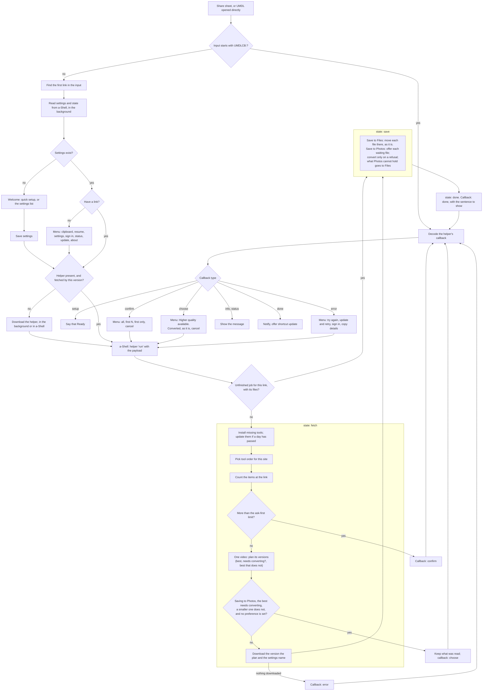

# Architecture

UMDL has two halves:

- **The shortcut** (`src/UMDL.cherri`) is everything you see in Shortcuts: reading the shared link, menus, settings, notifications.
- **The helper** (`src/umdl.py`) runs inside a-Shell. It downloads with yt-dlp or gallery-dl, saves the result to Photos, and reports back.

They talk in one direction at a time. The shortcut starts the helper with a command line. The helper answers by opening a `shortcuts://` URL that runs the shortcut again with the result as its input.

## Flow



There is one route. Version 1.5 removed the mode branch of 1.3 and 1.4 and moved saving into a-Shell; 1.6 removed the older way of saving through Shortcuts, so the shortcut no longer touches a file. The saving part is drawn on its own in [BEHAVIOR.md](BEHAVIOR.md#saving).

## A download is a job

`cmd_run` is a small state machine. A job is a dictionary, saved as `Working/<id>/job.json` after every step:

```
{"url": ..., "state": "fetch" | "save" | "done", "title": ..., "failed": 0,
 "items": [{"path": ..., "stem": "the name in Photos", "state": "waiting" | "saved" | "kept"}],
 "converted": ["VP9 → HEVC"]}
```

`MACHINE` maps a state's name to the function that carries it out. Each function does one thing, writes what it learned into the job, and returns the name of the next state. A state that cannot go on raises `Stop` with the callback to send (`confirm`, or `error`).

| State | Function | Does | Next |
|---|---|---|---|
| `fetch` | `state_fetch` | Runs the tools in order until one delivers; stages the files under plain names in `out/`. A tool may stop here with a question (`confirm`, `choose`); the answer arrives as a new run of the same job | `save` |
| `save` | `state_save` | With **Save to** Files: moves each item to `Saved/`. Otherwise opens Photos once; for each waiting item, `place()`; moves what is kept to `Saved/` | `done` |
| `done` | | The folder is removed and the callback sent | |

`<id>` is derived from the link, so the same link finds the same folder. `load_job` returns the saved job when it is in `save` and its waiting files are still there, and a new one otherwise; that is the whole of resuming. An item's path is saved again whenever a repack or a conversion replaces the file, so a second run offers Photos the newest file it has. An interrupted `fetch` is not a saved state: the tools are simply run again in the same folder, where yt-dlp continues a partly downloaded file by itself.

The first-run part of this chart is drawn in full in [BEHAVIOR.md](BEHAVIOR.md#first-run), which also describes every screen.

## Why a-Shell opens

a-Shell's Shortcuts actions run commands in two ways. "In extension" runs in the background and returns the output, but with tight memory and no Python. "In app" opens a-Shell and has the full environment.

UMDL uses the background mode for small things: reading settings, writing settings, checking the version file, downloading the helper script. Downloads need Python, so they open the app. iOS suspends an app that leaves the foreground, which is why a-Shell has to stay in front until the helper hands back.

## The payload (shortcut to helper)

A JSON object, base64-encoded so it survives a-Shell's command line whatever the link contains:

```
python umdl.py run <base64 JSON>
```

| Field | Meaning |
|---|---|
| `v` | Shortcut version |
| `p` | Protocol number |
| `name` | The shortcut's name, used for the callback |
| `url` | The link (or the shared text containing it) |
| `mode` | `auto` (ask above the limit), `all`, `limit`, `first` |
| `limit` | Item count for `mode: limit` |
| `convert` | The answer to "Higher quality available": `yes`, `no`, or empty when it was not asked |
| `force_update` | `1` to upgrade the tools before downloading |
| `cfg` | The settings: `album`, `dest` (`photos`, `files`), `convert` (`ask`, `yes`, `no`), `threshold`, `after`, `res` (`best` or a height), `fps` (`best`, `60`, `30`). `SETTINGS` in the helper lists what each may hold; anything else counts as the first value |

Other commands take the same payload: `setup`, `update`, `status`, `signin` (the page to open travels in `url`), `logout`, `reset`. A command the helper does not know, or a payload with another protocol number, is answered with an `outdated` error.

## The callback (helper to shortcut)

```
shortcuts://run-shortcut?name=UMDL&input=text&text=UMDLCB:<base64 JSON>
```

Every callback includes `cfg`, echoed from the payload, so the shortcut does not need a second trip to a-Shell to know the album.

| `t` | Other fields | The shortcut then |
|---|---|---|
| `done` | `title`; `msg`, the sentence to show; `open`, the link that shows where the download went (Photos, or the folder in Files); `upv` and `upurl` when a newer release exists | Notifies, and opens `open` if the setting says so |
| `confirm` | `url`, `n` item count or empty when only "more than" is known, `thr`, `title` | Asks how much to download |
| `choose` | `url`, `title`, `best` and `native`, the two sizes as text ("2160p60 HDR", "1080p60") | Asks **Higher quality available**, then runs the helper again with `convert` |
| `error` | `kind`, `msg`, `url` | Explains and offers fixes |
| `setup` | `ver` | Says that Ready |
| `info` | `title`, `msg` | Shows the message |
| `status` | `msg` | Shows the report and offers to copy it with the log |

Error kinds: `auth`, `network`, `gone`, `unsupported`, `drm`, `install`, `outdated`, `nolink`, `unknown`.

One result does not come from the helper. When the helper script cannot be downloaded in a-Shell, the shell itself reopens the shortcut with the plain text `UMDL-HELPER-MISSING`.

No file and no list of files is in a callback. By the time `done` is sent, every file is in Photos or in Files.

## Saving

a-Shell's Info.plist has declared `NSPhotoLibraryAddUsageDescription` since 2021, so its process may add to the Photos library. The helper does, with PhotoKit called through `ctypes` (`PhotosLibrary`): one `PHAssetCreationRequest` per file, with `originalFilename` set to the title, `creationDate` set to now, and the album added in the same change. `performChangesAndWait:error:` reports whether Photos took the file, which makes Photos itself the test of what it can play: the file is offered as it is, and converted only on a refusal.

Album access needs more than add-only permission. If the app also declares `NSPhotoLibraryUsageDescription` and an album is set, full access is asked for; otherwise, or if that is refused, files go to the library.

None of this can run off a device, so it is fenced:

- `open_library()` returns the library, or nothing and the reason in a sentence: the declarations are missing, access is refused, or Photos could not be reached. The reason ends the notification.
- Before each step, the step's name is written to `photos.step`, and removed after. If a-Shell stops in between, the next run finds the name, records it with the helper's version, and keeps files in Files, saying so, until a different helper is installed or **Update tools** is run.
- Any error from the calls ends saving to Photos for that run. The files are kept in Files.

Files is the only other place a file can end. Versions before 1.6 could also hand files to Shortcuts through a-Shell's "Get File" action. That route is gone: on iOS 27.2 it needs a-Shell to read the whole file into memory ([a-Shell issue 1138](https://github.com/holzschu/a-shell/issues/1138)), which stops a-Shell on large files, and the copy arrives named after its path.

a-Shell reports a background action as failed when the last command exits with an error, unless `keepGoing` is set, and Shortcuts then stops without naming a reason. Every background command UMDL sends sets `keepGoing`, and reads the output to decide what happened.

`Library.add` is shared by the real library and the tests' stand-in. When a file is refused and an album is set, it tries once more without the album: if that also fails, the file was the problem and the album is kept for the next one; if it works, the album was, and the library is used for the rest of the run. Photos gives the same error (3302) for both, which is why it has to be tried.

## Sign-ins

a-Shell's `internalbrowser` is a web view inside the app. Its cookies are stored in `~/Library/Cookies/Cookies.binarycookies`, which is where yt-dlp and gallery-dl look when told to use Safari's cookies, so a sign-in made there is available to both tools with nothing copied.

The helper reads the same file to answer one question: is this site signed in? It parses the names and domains only, never the values. For the listed sites it looks for the site's own session cookie (`sessionid` for Instagram, `reddit_session` for Reddit, and so on); for any other site, for a cookie whose name looks like a session. `signin` opens the page, polls the file until that cookie appears or ten minutes pass, and calls back either way. `status` uses the same check.

## Files in a-Shell

Everything is under `~/Documents/UMDL`, visible in the Files app as *a-Shell › UMDL*.

| Path | Purpose |
|---|---|
| `umdl.py` | The helper |
| `helper.for` | The shortcut version that downloaded the helper. A different version downloads it again |
| `config.b64` | Settings, as base64 JSON |
| `state.json` | When the tools and the version file were last checked, any extra folder pip installs to, and what was learned about Photos on this device (`photos_off`) |
| `Working/<id>/` | Working folder for one link, removed when the download is done. `<id>` is derived from the link, so the same link carries on |
| `Working/<id>/job.json` | The job: its state and its files. See [A download is a job](#a-download-is-a-job) |
| `Working/<id>/info.json` | What yt-dlp read from the link, kept while a question is being asked so the answer's run reads nothing twice. Used once, within half an hour |
| `Working/<id>/out/` | Downloaded files under plain names (`001-My-clip.mp4`) |
| `photos.step` | The step of saving to Photos that is under way. Left behind only if a-Shell stopped during it |
| `last.b64` | The payload of a download in progress; left behind only if it was interrupted |
| `last.log` | Log of the last run |
| `Saved/` | Files Photos cannot hold |

## Quality

`ytdlp_format` builds the format string from alternatives, first match wins:

1. `bv*[vcodec~='^(avc|h264|hev|hvc|h265)']+ba/b[…]`, only when **Conversion** is "Never": the best version Photos takes as it is.
2. `bv*[fps<=?30]+ba/b[fps<=?30]`, only with a frame rate limit. It cannot be a sort field: placed after `res` it would never apply where a site's larger versions are all 60 frames a second.
3. `bv*+ba/b/ba`, the best there is.

What "best" means is given to yt-dlp as sort fields, `lang, res, fps, vcodec:h265, acodec:aac`:

- `res` and `fps` first, so size and smoothness decide before anything else. A resolution limit turns `res` into `res:1080`, which yt-dlp reads as "the largest up to this, and the smallest above it only when nothing fits".
- `vcodec:h265` and `acodec:aac` after them. These rank H.265, then H.264, above VP9 and AV1, and AAC above Opus, but only between versions already equal in size and frame rate.
- `lang` leads so that the sound stays in the original language whatever its codec.

For a single video the helper then looks at the list itself. `plan_versions` returns the best version (`take`), whether Photos will need it converted (`converts`), and, when it will and a smaller version would not, that one (`native`). Among versions equal to yt-dlp's best in size and frame rate, H.264 and HEVC rank first, AV1 next where `av1_verdict()` allows, VP9 after. The ids chosen go in front of the format string, `401+140/bv*+ba/b/ba`, so anything unexpected falls through to yt-dlp's own choice. With `native` in the plan, **Save to** Photos and no preference, the engine raises `Stop` with a `choose` reply.

Why AV1 before VP9: Photos takes neither (error 3302 for AV1, seen on a device), so the order is about conversion time. `VTIsHardwareDecodeSupported('av01')` is true on an iPhone 15 Pro and later, with no entitlement needed. VP9's hardware decoder is behind `com.apple.developer.coremedia.allow-alternate-video-decoder-selection`, which Apple grants to few apps (YouTube's has it) and a-Shell does not have, so ffmpeg reads VP9 in software. The verdict also needs an ffmpeg that can read AV1: `libdav1d` or `libaom-av1`, or its own `av1` decoder together with VideoToolbox. a-Shell 2.4's build (`n7.0-2875-g991ecfec60`) converted a 4K60 HDR AV1 video of 127 seconds in 121.

A conversion, when Photos refuses a file, never changes the picture's size or frame rate. `conversion_attempts` returns the ffmpeg arguments to try, in order, limited to the encoders `ffmpeg -encoders` reports:

1. `hevc_videotoolbox -tag:v hvc1 -b:v <rate>`, with `main10` and `p010le` for a 10-bit source. The rate is the source's times `HEADROOM` (1.6 for AV1, 1.3 for VP9, 1.1 otherwise), at least the floor for the size, at most 80 Mbit/s. A quality level (`-q:v`) is not asked for: on iOS ffmpeg refuses it for this encoder.
2. `h264_videotoolbox -profile:v high -b:v <1.6 × rate>`.
3. `libx264 -crf 17 -preset veryfast`.

For an HDR source, `-vf setparams=color_primaries=…:color_trc=…:colorspace=…` is added to each, with the values ffprobe reports, so HDR stays HDR. A filter, because newer ffmpeg takes the encoder's colour settings from the frames and ignores the same values given as options.

Each attempt is made with `-hwaccel videotoolbox` in front of the input when `ffmpeg -hwaccels` lists it, and once more without if every encoder fails that way. A failed attempt is not repeated. Progress is read from a file ffmpeg writes (`-progress <file>`), not from its output. The log line for a conversion gives the arguments used and the seconds it took.

The size in "Converting 2160p60 VP9 + Opus" comes from `tier()`, which names a picture after the 16:9 frame it fills: 3840×1920 is 2160p.

## Which tool goes first

- A site in `SOURCES`: whatever the table names. Reddit is the one entry, and it names the browser route below.
- A site known for image or mixed posts (X, Instagram, Bluesky, Imgur, Pixiv and others): gallery-dl, then yt-dlp.
- Any other site yt-dlp has an extractor for: yt-dlp, then gallery-dl if it also knows the site.
- A site only gallery-dl knows: gallery-dl, then yt-dlp's generic extractor.
- Neither: yt-dlp's generic extractor, which looks for media in the page.

The second tool runs only if the first produced nothing. If both fail, the first tool's error is the one shown.

## Reddit, read from its page

Both tools read a Reddit post from `www.reddit.com/…/.json`. Around 9 October 2026 Reddit began answering those addresses with "You've been blocked by network security" for everyone: any network, signed in or not, with or without a browser's TLS fingerprint, and even when a browser navigates to them. gallery-dl's and yt-dlp's trackers carry the reports. New API applications are no longer granted to individuals, so the API is not a way round for a tool users install themselves. What Reddit still serves is the post's page, and only to a client that runs its scripts: a plain request for the page gets a checking page.

The first device log of 1.7.0 showed the whole of it at once: gallery-dl blocked while resolving the share link; yt-dlp not recognising the `/s/` share form and failing as a generic site; and the browser route, which asked for the `.json` and then fetched the page with `fetch()`, refused on both. A `fetch()` is not a visit.

So the helper makes a visit. a-Shell's `jsc` command runs JavaScript in the web view behind `internalbrowser`, the one a sign-in happens in. `reddit_post_from_browser`:

1. reads where the web view is and how deep its history is;
2. if it is not on `www.reddit.com`, sets `location.href` to `https://www.reddit.com/robots.txt`, a page that runs nothing and that no app claims, and waits for it;
3. sets `location.href` to the post's page (`reddit_page()`: the path as shared, on `www.reddit.com`). From a page of the same site this is an ordinary link, which iOS leaves in the browser; opened from elsewhere it could start the Reddit app, as YouTube's did;
4. runs `REDDIT_LOOK` every half second for up to 40 seconds. It answers `OK` and a small JSON object once a `<shreddit-post>` element is on the page, and until then describes the page (address, state, title, first words), which is what the log shows when a post never appears;
5. goes back to where the web view was: `history.go(depth - history.length)`.

`umdlRead(html)` is given the post element as the browser writes it out and reads: `id`, `post-title`, `post-type` and `content-href` from the element's own attributes; a `v.redd.it/<id>` anywhere inside, which becomes `https://v.redd.it/<id>/DASHPlaylist.mpd`; and image names on `i.redd.it` or `preview.redd.it`, each rewritten to the original on `i.redd.it`. Only the post element is read, so avatars and pictures in comments are not picked up. The result is one of `video` (to yt-dlp), `files` (to gallery-dl as direct links), `link` (another site, through the normal order) or `none`.

`jsc` does not wait for promises and, on iOS 27.2, refuses to hand back a script's value, so every script reports through `window.webkit.messageHandlers.aShell.postMessage("print:…")` and ends in `void 0`.

None of this can be tried against Reddit from where UMDL is built: Reddit is blocked there. The reader runs in Node against pages modelled on Reddit's markup (`tests/reddit_pages.py`, `tests/test_reddit_js.py`), and the flow tests use a stand-in browser that executes the helper's scripts. Whether Reddit serves the page to a-Shell's web view, and whether its media hosts accept the tools, are for the device to say; the log records each step.

## Hardware decoding: what is and is not reachable

A conversion reads the source and writes HEVC. Writing is always hardware (`hevc_videotoolbox`). Reading depends on the source:

| Source | Hardware on an iPhone | Reachable from a-Shell | Measured |
|---|---|---|---|
| H.264, HEVC | Yes | Not needed: Photos takes them | |
| AV1 | iPhone 15 Pro and later | Yes. VideoToolbox gives it to any app | 2160p60 HDR, 127 s of video in 103 s |
| VP9 | On some chips; Apple does not say which | No. VideoToolbox gives VP9 only to apps holding `com.apple.developer.coremedia.allow-alternate-video-decoder-selection`, which Apple grants to few. a-Shell cannot add it: an app re-signed with an entitlement its profile lacks does not install | 2% after several minutes at 2160p, in software |

Routes round the VP9 limit that were looked at:

- **AV1 instead.** Done: `plan_versions` takes AV1 over VP9 at the same size and frame rate. YouTube has AV1 for most 4K videos; the slow case is left to those it has only in VP9.
- **WebKit's decoder, through WebCodecs.** WebKit's own processes hold the permission a-Shell lacks, and Safari has had `VideoDecoder` and `VideoEncoder` since 16.4, VP9 included. a-Shell's web view could in principle decode VP9 and encode HEVC itself, with a demuxer and an MP4 writer in JavaScript and the file passed through `jsc` in pieces. That is a transcoder of its own, and it would lose 10-bit HDR unless the encoder there accepts it. Before any of that, one fact is needed: whether the web view decodes VP9 in hardware on a given phone. Status now asks it (`CODEC_PROBE`, the "Web view" line).
- **AVFoundation from Python.** Same decoder, same entitlement.
- **Not converting.** **Save to › Files**, or **Conversion › Never**.

## YouTube in a web view

YouTube's stream addresses carry challenges that only the site's own player code can answer, so yt-dlp runs that code in a JavaScript runtime. a-Shell has none of the stand-alone ones (Deno, Node, Bun, QuickJS). The `yt-dlp-apple-webkit-jsi` plugin fills the gap by running the code in a `WKWebView` inside a-Shell's process.

yt-dlp's solver script (`yt-dlp-ejs`) prepares the ground for the player code with a few assignments, one of which is

```js
globalThis.location = new URL("https://www.youtube.com/watch?v=yt-dlp-wins");
```

In a stand-alone runtime this creates a variable. In a web view `globalThis` is the window, and assigning to a window's location navigates it. The plugin's web view has no say over navigations, so WebKit applies its default: a main-frame navigation to another site's universal link is offered to the app that owns it. iOS opens the YouTube app on the video `yt-dlp-wins`, which does not exist, and a-Shell is left in the background, where it finishes its work but may not open the `shortcuts://` link that hands the result back.

`tame_solver()` wraps the method of yt-dlp that assembles the script (`EJSBaseJCP._construct_stdin`) and, for a runtime whose name says it is a web view, renames the target of such assignments to `umdlLocation`. Reads of `location` are untouched. The player code then sees the web view's real location, `about:blank`, which is also what it saw before: the navigation was asynchronous and the challenges were solved before it took effect. If a later yt-dlp moves that method, the wrap finds nothing, says so in the log, and changes nothing.

The same hazard applies to any script UMDL itself runs in a-Shell's web view, which is why the Reddit route enters the site through `robots.txt` first; that step did not start the Reddit app on the test device.

## Staying current

- **Tools**: yt-dlp and gallery-dl are installed with a-Shell's own pip, with no virtual environment. The shortcut runs pip in the a-Shell window whenever it has just downloaded the helper. The helper then checks for itself on every run: a missing tool is installed, one package at a time so that one failure does not hold back the rest, and if pip reports a location Python is not searching, that folder is added and remembered. Tools are upgraded once a day, and on demand.
- **Helper, first copy**: downloaded by the shortcut, which records its own version next to it. A shortcut of another version downloads the helper again, so the two always match after an update.
- **Helper**: once a day the helper reads `version.json` from this repository. If `helper` is newer and `protocol` matches, it downloads the new `src/umdl.py`, checks that it compiles, and swaps it in for the next run.
- **Shortcut**: the same check notes a newer `shortcut` version, and the shortcut offers the release page after the next download.

Bump `protocol` only when the payload or callback changes incompatibly. A helper will not update itself across a protocol change, so an old shortcut keeps a helper it can talk to.

## Things that look odd but are deliberate

- **File names are `001.mp4`, not titles.** a-Shell has no fork/exec, so commands are passed as one string. Names without spaces or symbols cannot be mis-parsed. Titles are restored for files kept in Files.
- **The shortcut is linear, with flags.** Each section runs if its flag is set, and shared steps (saving settings, launching a-Shell) appear once near the end.
- **Settings is a counted loop.** Shortcuts has no "repeat until". The list sits in a "Repeat 40 times" whose body is skipped once **Done** is tapped, which is what keeps the list on screen between changes without a second level of menus.
- **"Open App" then a one-second wait before each foreground command.** Copied from SW-DLT, where it makes the hand-off to a-Shell reliable.
- **Emptiness is never tested with "has any value".** On a device an empty text counts as a value, so that test is true when it looks like it should be false. The shortcut wraps the text in brackets and compares with `[]`. A test fails the build if a "has any value" condition appears.
- **Dictionary conversions are guarded.** Shortcuts stops with an error if asked to turn non-JSON text into a dictionary, so anything that came over the network or from disk is checked for an expected key first.
