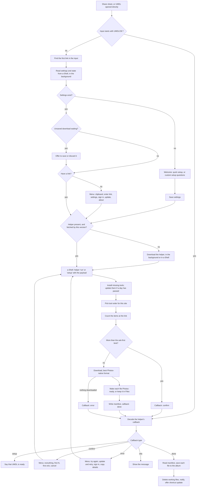

# Architecture

UMDL has two halves:

- **The shortcut** (`src/UMDL.cherri`) is everything you see in Shortcuts: reading the shared link, menus, settings, saving to Photos, notifications.
- **The helper** (`src/umdl.py`) runs inside a-Shell. It downloads with yt-dlp or gallery-dl, makes the result importable by Photos, and reports back.

They talk in one direction at a time. The shortcut starts the helper with a command line. The helper answers by opening a `shortcuts://` URL that runs the shortcut again with the result as its input.

## Flow



The first-run part of this chart is drawn in full in [BEHAVIOR.md](BEHAVIOR.md#first-run), which also describes every screen.

## Why a-Shell opens

a-Shell's Shortcuts actions run commands in two ways. "In extension" runs in the background and returns the output, but with tight memory and no Python. "In app" opens a-Shell and has the full environment.

UMDL uses the background mode for small things: reading settings, writing settings, deleting working files, checking the version file, downloading the helper script. Downloads need Python, so they open the app. iOS suspends an app that leaves the foreground, which is why a-Shell has to stay in front until the helper hands back.

## The payload (shortcut to helper)

A JSON object, base64-encoded so it survives a-Shell's command line whatever the link contains:

```
python umdl.py run <base64 JSON>
```

| Field | Meaning |
|---|---|
| `v` | Shortcut version |
| `p` | Protocol number |
| `name` | The shortcut's name, used for the callback |
| `url` | The link (or the shared text containing it) |
| `mode` | `auto` (ask above the limit), `all`, `limit`, `first` |
| `limit` | Item count for `mode: limit` |
| `force_update` | `1` to upgrade the tools before downloading |
| `cfg` | The settings: `album`, `threshold`, `convert`, `after` |

Other commands take the same payload: `setup`, `update`, `status`, `signin` (the page to open travels in `url`), `logout`. `doctor` is kept as an older name for `status`. A command the helper does not know, or a payload with another protocol number, is answered with an `outdated` error.

## The callback (helper to shortcut)

```
shortcuts://run-shortcut?name=UMDL&input=text&text=UMDLCB:<base64 JSON>
```

Every callback includes `cfg`, echoed from the payload, so the shortcut does not need a second trip to a-Shell to know the album.

| `t` | Other fields | The shortcut then |
|---|---|---|
| `done` | `m` manifest path, `np` Photos count, `nk` kept-in-Files count, `nf` failed count, `nb` count kept in Files for being over 1 GB, `title`, and `upv` and `upurl` when a newer release exists | Saves and notifies |
| `confirm` | `url`, `n` item count or empty when only "more than" is known, `thr`, `title` | Asks how much to download |
| `error` | `kind`, `msg`, `url` | Explains and offers fixes |
| `setup` | `ver` | Says that UMDL is ready |
| `info` | `title`, `msg` | Shows the message |
| `status` | `msg` | Shows the report and offers to copy it with the log |

Error kinds: `auth`, `network`, `gone`, `unsupported`, `drm`, `install`, `outdated`, `nolink`, `unknown`.

One result does not come from the helper. When the helper script cannot be downloaded in a-Shell, the shell itself reopens the shortcut with the plain text `UMDL-HELPER-MISSING`.

The file list is not in the callback. It is in the manifest (`jobs/<id>/manifest.json`), which the shortcut reads with a background `cat`, so a 500-item download does not need a 500-item URL. Each file is then fetched with a-Shell's "Get File".

## Getting files out of a-Shell

"Get File" has two modes. By default a-Shell hands Shortcuts a reference to the file. On iOS 27.2 that mode stops the shortcut with "There was a problem running the shortcut" ([a-Shell issue 1138](https://github.com/holzschu/a-shell/issues/1138)). With `copyFile` set, a-Shell reads the file into memory and hands over the data, which works on 27.2 but times out somewhere between 500 MB and 2 GB. UMDL always sets `copyFile`, and the helper keeps any file over 1 GB in Files instead of listing it for Photos.

Background commands have a similar trap. a-Shell reports the action as failed when the last command exits with an error, unless `keepGoing` is set, and Shortcuts then stops in the same wordless way. Every background command UMDL sends sets `keepGoing`, and reads the output to decide what happened.

## Sign-ins

a-Shell's `internalbrowser` is a web view inside the app. Its cookies are stored in `~/Library/Cookies/Cookies.binarycookies`, which is where yt-dlp and gallery-dl look when told to use Safari's cookies, so a sign-in made there is available to both tools with nothing copied.

The helper reads the same file to answer one question: is this site signed in? It parses the names and domains only, never the values. For the listed sites it looks for the site's own session cookie (`sessionid` for Instagram, `reddit_session` for Reddit, and so on); for any other site, for a cookie whose name looks like a session. `signin` opens the page, polls the file until that cookie appears or ten minutes pass, and calls back either way. `status` uses the same check.

## Files in a-Shell

Everything is under `~/Documents/UMDL`, visible in the Files app as *a-Shell › UMDL*.

| Path | Purpose |
|---|---|
| `umdl.py` | The helper |
| `helper.for` | The shortcut version that downloaded the helper. A different version downloads it again |
| `config.b64` | Settings, as base64 JSON |
| `state.json` | When the tools and the version file were last checked, and any extra folder pip installs to |
| `jobs/<id>/` | Working folder for one link. `<id>` is derived from the link, so sharing the same link again resumes |
| `jobs/<id>/out/` | Finished files with plain names (`001.mp4`) |
| `jobs/<id>/manifest.json` | What to save to Photos and what was kept |
| `pending` | Path of a manifest that has not been saved to Photos yet |
| `last.b64` | The payload of a download in progress; left behind only if it was interrupted |
| `last.log` | Log of the last run |
| `Saved/` | Files Photos cannot hold |

## Quality

yt-dlp is given this preference list, first match wins:

1. Best video in H.264 or HEVC, plus best AAC-family audio
2. Best single file with both
3. Best H.264 or HEVC video, plus any audio
4. Best H.264 or HEVC single file
5. Best MP4 or MOV whose codecs the site does not state
6. Best of anything, video then audio-only

After download every video is inspected with ffprobe, because what a site says and what it serves can differ:

| Found | Action |
|---|---|
| H.264 or HEVC, compatible audio, MP4 or MOV | Used as is |
| Right video codec, wrong container or audio | Rewrapped; video is copied, audio re-encoded only if needed |
| HEVC tagged `hev1` | Retagged `hvc1`, which Apple players require |
| Any other video codec | Converted with the hardware H.264 encoder if the setting allows, with a software fallback; otherwise kept in Files |
| No video stream | Kept in Files |

## Which tool goes first

- A site known for image or mixed posts (X, Instagram, Reddit, Bluesky, Imgur, Pixiv and others): gallery-dl, then yt-dlp.
- Any other site yt-dlp has an extractor for: yt-dlp, then gallery-dl if it also knows the site.
- A site only gallery-dl knows: gallery-dl, then yt-dlp's generic extractor.
- Neither: yt-dlp's generic extractor, which looks for media in the page.

The second tool runs only if the first produced nothing. If both fail, the first tool's error is the one shown.

## Staying current

- **Tools**: yt-dlp and gallery-dl are installed with a-Shell's own pip, with no virtual environment. The shortcut runs pip in the a-Shell window whenever it has just downloaded the helper. The helper then checks for itself on every run: a missing tool is installed, one package at a time so that one failure does not hold back the rest, and if pip reports a location Python is not searching, that folder is added and remembered. Tools are upgraded once a day, and on demand.
- **Helper, first copy**: downloaded by the shortcut, which records its own version next to it. A shortcut of another version downloads the helper again, so the two always match after an update.
- **Helper**: once a day the helper reads `version.json` from this repository. If `helper` is newer and `protocol` matches, it downloads the new `src/umdl.py`, checks that it compiles, and swaps it in for the next run.
- **Shortcut**: the same check notes a newer `shortcut` version, and the shortcut offers the release page after the next download.

Bump `protocol` only when the payload or callback changes incompatibly. A helper will not update itself across a protocol change, so an old shortcut keeps a helper it can talk to.

## Things that look odd but are deliberate

- **File names are `001.mp4`, not titles.** a-Shell has no fork/exec, so commands are passed as one string. Names without spaces or symbols cannot be mis-parsed. Titles are restored for files kept in Files.
- **The shortcut is linear, with flags.** Shortcuts has no functions or loops to speak of. Each section runs if its flag is set, and shared steps (the album question, saving settings, launching a-Shell) appear once near the end.
- **"Open App" then a one-second wait before each foreground command.** Copied from SW-DLT, where it makes the hand-off to a-Shell reliable.
- **Emptiness is never tested with "has any value".** On a device an empty text counts as a value, so that test is true when it looks like it should be false. The shortcut wraps the text in brackets and compares with `[]`. A test fails the build if a "has any value" condition appears.
- **Dictionary conversions are guarded.** Shortcuts stops with an error if asked to turn non-JSON text into a dictionary, so anything that came over the network or from disk is checked for an expected key first.
