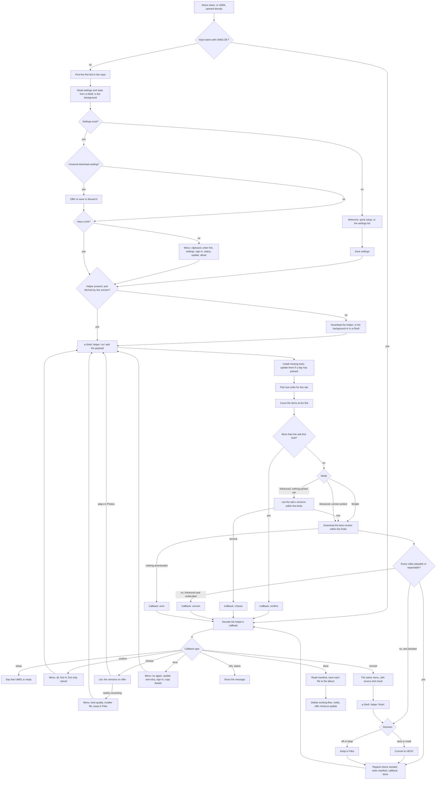

# Architecture

UMDL has two halves:

- **The shortcut** (`src/UMDL.cherri`) is everything you see in Shortcuts: reading the shared link, menus, settings, saving to Photos, notifications.
- **The helper** (`src/umdl.py`) runs inside a-Shell. It downloads with yt-dlp or gallery-dl, makes the result importable by Photos, and reports back.

They talk in one direction at a time. The shortcut starts the helper with a command line. The helper answers by opening a `shortcuts://` URL that runs the shortcut again with the result as its input.

## Flow



Version 1.3 added the **Mode** branch and the two callbacks it needs, `choose` and `convert`. Version 1.4 separated the two decisions in it: which version to download depends only on the resolution and frame rate limits, and what to do with a file Photos cannot play is decided afterwards, by the Convert setting in simple mode and by a question in advanced mode. The part from "Mode" to "Save to Photos" is drawn on its own in [BEHAVIOR.md](BEHAVIOR.md#which-version-is-downloaded).

The first-run part of this chart is drawn in full in [BEHAVIOR.md](BEHAVIOR.md#first-run), which also describes every screen.

## Why a-Shell opens

a-Shell's Shortcuts actions run commands in two ways. "In extension" runs in the background and returns the output, but with tight memory and no Python. "In app" opens a-Shell and has the full environment.

UMDL uses the background mode for small things: reading settings, writing settings, deleting working files, checking the version file, downloading the helper script. Downloads need Python, so they open the app. iOS suspends an app that leaves the foreground, which is why a-Shell has to stay in front until the helper hands back.

## The payload (shortcut to helper)

A JSON object, base64-encoded so it survives a-Shell's command line whatever the link contains:

```
python umdl.py run <base64 JSON>
```

| Field | Meaning |
|---|---|
| `v` | Shortcut version |
| `p` | Protocol number |
| `name` | The shortcut's name, used for the callback |
| `url` | The link (or the shared text containing it) |
| `mode` | `auto` (ask above the limit), `all`, `limit`, `first` |
| `limit` | Item count for `mode: limit` |
| `force_update` | `1` to upgrade the tools before downloading |
| `pick` | Advanced mode: the title of the row chosen. Empty on the first request. The helper compares letters and digits only, so a title survives whatever Shortcuts does to its symbols |
| `decision` | Advanced mode: `best`, `small` or `keep`. Sent with `pick` when the version chosen needs converting, and with `finish` |
| `cfg` | The settings: `album`, `threshold`, `after`, `mode` (`simple`, `advanced`), `res` (`best` or a height), `fps` (`best`, `60`, `30`), `convert` (`best`, `small`, `off`; values stored by earlier versions are mapped) |

Other commands take the same payload: `finish` (the second half of an advanced-mode download), `setup`, `update`, `status`, `signin` (the page to open travels in `url`), `logout`, `reset`. A command the helper does not know, or a payload with another protocol number, is answered with an `outdated` error.

## The callback (helper to shortcut)

```
shortcuts://run-shortcut?name=UMDL&input=text&text=UMDLCB:<base64 JSON>
```

Every callback includes `cfg`, echoed from the payload, so the shortcut does not need a second trip to a-Shell to know the album.

| `t` | Other fields | The shortcut then |
|---|---|---|
| `done` | `m` manifest path, `np` Photos count, `nk` kept-in-Files count, `nf` failed count, `nb` count kept in Files for being over 1 GB, `nc` converted count and `conv` what was converted ("VP9 → HEVC"), `title`, and `upv` and `upurl` when a newer release exists | Saves and notifies |
| `confirm` | `url`, `n` item count or empty when only "more than" is known, `thr`, `title` | Asks how much to download |
| `choose` | `url`, `info` what the site offers, `cards` the rows to list, `mode` and `limit` carried over from a `confirm` | Lists the versions, asks how to convert if the one chosen needs it, then sends `run` again with `pick` and `decision` |
| `convert` | `url`, `n`, `info` the source and what it would become | Asks, then sends `finish` with `decision` |
| `error` | `kind`, `msg`, `url` | Explains and offers fixes |
| `setup` | `ver` | Says that UMDL is ready |
| `info` | `title`, `msg` | Shows the message |
| `status` | `msg` | Shows the report and offers to copy it with the log |

Error kinds: `auth`, `network`, `gone`, `unsupported`, `drm`, `install`, `outdated`, `nolink`, `unknown`.

One result does not come from the helper. When the helper script cannot be downloaded in a-Shell, the shell itself reopens the shortcut with the plain text `UMDL-HELPER-MISSING`.

The file list is not in the callback. It is in the manifest (`jobs/<id>/manifest.json`), which the shortcut reads with a background `cat`, so a 500-item download does not need a 500-item URL. Each file is then fetched with a-Shell's "Get File".

## Getting files out of a-Shell

"Get File" has two modes. By default a-Shell hands Shortcuts a reference to the file. On iOS 27.2 that mode stops the shortcut with "There was a problem running the shortcut" ([a-Shell issue 1138](https://github.com/holzschu/a-shell/issues/1138)). With `copyFile` set, a-Shell reads the file into memory and hands over the data, which works on 27.2 but times out somewhere between 500 MB and 2 GB. UMDL always sets `copyFile`, and the helper keeps any file over 1 GB in Files instead of listing it for Photos.

Background commands have a similar trap. a-Shell reports the action as failed when the last command exits with an error, unless `keepGoing` is set, and Shortcuts then stops in the same wordless way. Every background command UMDL sends sets `keepGoing`, and reads the output to decide what happened.

## Sign-ins

a-Shell's `internalbrowser` is a web view inside the app. Its cookies are stored in `~/Library/Cookies/Cookies.binarycookies`, which is where yt-dlp and gallery-dl look when told to use Safari's cookies, so a sign-in made there is available to both tools with nothing copied.

The helper reads the same file to answer one question: is this site signed in? It parses the names and domains only, never the values. For the listed sites it looks for the site's own session cookie (`sessionid` for Instagram, `reddit_session` for Reddit, and so on); for any other site, for a cookie whose name looks like a session. `signin` opens the page, polls the file until that cookie appears or ten minutes pass, and calls back either way. `status` uses the same check.

## Files in a-Shell

Everything is under `~/Documents/UMDL`, visible in the Files app as *a-Shell › UMDL*.

| Path | Purpose |
|---|---|
| `umdl.py` | The helper |
| `helper.for` | The shortcut version that downloaded the helper. A different version downloads it again |
| `config.b64` | Settings, as base64 JSON |
| `state.json` | When the tools and the version file were last checked, and any extra folder pip installs to |
| `jobs/<id>/` | Working folder for one link. `<id>` is derived from the link, so sharing the same link again resumes |
| `jobs/<id>/out/` | Finished files with plain names (`001.mp4`) |
| `jobs/<id>/manifest.json` | What to save to Photos and what was kept |
| `jobs/<id>/plan.json` | Advanced mode: the versions that were offered, so the label that comes back can be matched to a format |
| `jobs/<id>/job.json` | Advanced mode: the downloaded files waiting for the convert-or-keep answer |
| `pending` | Path of a manifest that has not been saved to Photos yet |
| `last.b64` | The payload of a download in progress; left behind only if it was interrupted |
| `last.log` | Log of the last run |
| `Saved/` | Files Photos cannot hold |

## Quality

Two decisions, kept apart: which version to download, and what to do with a file Photos cannot play.

**Which version.** The format string is always `bv*+ba/b/ba`, the best there is. What "best" means is given to yt-dlp as sort fields, `lang, res, fps, vcodec:h265, acodec:aac`:

- `res` and `fps` first, so size and smoothness decide before anything else. A resolution limit turns `res` into `res:1080`, which yt-dlp reads as "the largest up to this, and the smallest above it only when nothing fits".
- `vcodec:h265` and `acodec:aac` after them. These rank H.265, then H.264, above VP9 and AV1, and AAC above Opus, but only between versions already equal in size and frame rate. A version Photos plays is therefore preferred when it costs nothing, and never at the price of a smaller picture.
- `lang` leads so that the sound stays in the original language whatever its codec.

A frame rate limit cannot be a sort field: placed after `res` it would never apply where a site's larger versions are all 60 frames a second, and placed before it would prefer 30 frames over 25 before looking at size. It is a filter with a fallback instead: `bv*[fps<=?30]+ba/b[fps<=?30]/bv*+ba/b/ba`.

The conversion setting appears nowhere in this. One other format string exists, `YTDLP_FORMAT`, which admits only what Photos plays unless the site has nothing else; it is used when advanced mode's "Best without converting" is chosen for a link with several videos.

**Advanced mode** replaces the format string with the exact formats behind the row that was picked, followed by the string above as a fallback in case the site's list changed between the two requests. The plan is built from yt-dlp's format list by the same rule, written out in `build_plan`: a frame rate limit first, then the largest picture within the resolution limit, the higher frame rate, a codec Photos plays, the higher bitrate; and for sound AAC if the site has it, otherwise the highest bitrate. Each row carries exact format ids, so what is listed is what is fetched. The codec after the arrow is the one this device's ffmpeg will produce.

The rows travel as vCard text, the format the shortcut's own icon menus use. Where a picture belongs the helper writes a marker, `@UMDL-ICON-GET@` or `@UMDL-ICON-CONVERT@`, and the shortcut puts in the icon it carries. The list is then shown by the same actions as the main menu, which are known to work on a device; the first version of this list was built from a JSON array and was never seen in the one device test it had.

**After the download** every video is inspected with ffprobe, because what a site says and what it serves can differ:

| Found | Verdict | Action |
|---|---|---|
| H.264 or HEVC, compatible audio, MP4 or MOV | ready | Used as is |
| Right video codec, wrong container or audio | repack | Rewrapped; video is copied, audio re-encoded to AAC 256 kbit/s only where Photos cannot play it |
| HEVC tagged `hev1` | repack | Retagged `hvc1`, which Apple players require |
| Any other video codec | convert | By the decision: `best`, `small`, or kept in Files |
| No video stream | files | Kept in Files |

The decision comes from the Convert setting in simple mode. In advanced mode it comes from the question asked with the version, or, when no version was asked about or the file turned out differently, from a `convert` callback after the download.

A conversion never changes the picture's size or frame rate. `conversion_attempts` returns the ffmpeg arguments to try, in order, limited to the encoders `ffmpeg -encoders` reports. For `best`:

1. `hevc_videotoolbox -q:v 75 -tag:v hvc1`. The device's hardware encoder in constant-quality mode, so the bitrate follows the picture. `main10` and `p010le` are added for a 10-bit source.
2. `hevc_videotoolbox -b:v <rate>`. The same encoder by bitrate, for an ffmpeg build without the quality mode, which iOS builds may be. The rate is 1.1 times the source's, with a floor by resolution and a ceiling of 80 Mbit/s.
3. `h264_videotoolbox -profile:v high -b:v <1.6 × rate>`.
4. `libx264 -crf 17 -preset veryfast`. Software, slow, visually lossless.

For `small` the same four with quality 55, about half the bitrate, and `-crf 23`. The first that produces a file wins and is named in the log and in the notification. HEVC comes first because it is the only one of these that carries 4K at 60 frames a second and 10-bit colour at a size worth keeping, and every device that runs a-Shell plays it.

Progress is read from a file ffmpeg writes (`-progress <file>`), not from its output, because reading the output of a running command is not something a-Shell is known to allow. If ffmpeg fails with that option, the same step is tried once more without it.

HDR is not sought out. Where a site has both, the sort prefers the plain VP9 version to the HDR one of the same size, because whether the colour information survives the hardware encoder has not been checked on a device.

## Which tool goes first

- A site known for image or mixed posts (X, Instagram, Reddit, Bluesky, Imgur, Pixiv and others): gallery-dl, then yt-dlp.
- Any other site yt-dlp has an extractor for: yt-dlp, then gallery-dl if it also knows the site.
- A site only gallery-dl knows: gallery-dl, then yt-dlp's generic extractor.
- Neither: yt-dlp's generic extractor, which looks for media in the page.

The second tool runs only if the first produced nothing. If both fail, the first tool's error is the one shown.

Reddit gets one more attempt. Both tools read a post from `www.reddit.com/…/.json`, and Reddit refuses that to many networks with "You've been blocked by network security", signed in or not; yt-dlp words the same refusal as "Your IP address is unable to access the Reddit API". The block page points to Reddit's API as the alternative, so when gallery-dl is blocked the helper runs it again with `-o api=oauth -o refresh-token=`, which makes it request a public API token and read the post from `oauth.reddit.com`. The empty `refresh-token` matters: without it gallery-dl 1.32.21 stops with an `AttributeError` before making any request.

On the test device that was refused as well, so there is a last route that does not depend on Reddit accepting a download tool at all. a-Shell has a real browser: the web view behind `internalbrowser`, which is also where the sign-in lives. a-Shell's `jsc` command runs JavaScript in that web view. The helper sends the web view to `www.reddit.com/robots.txt` (a page of the site that runs no scripts), runs a short script there that follows the share link and fetches the post's JSON as the signed-in browser, polls for the answer, and sends the web view back with `history.back()`. From the answer it takes only where the media is: a DASH manifest on `v.redd.it` for a video, which goes to yt-dlp; original files on `i.redd.it` for photos and galleries, which go to gallery-dl as direct links; or a link to another site, which goes through the normal tool order. Those hosts are plain file servers and take no part in the block. `jsc` does not wait for a script's promises, so the script stores its answer in the page and a second script reads it. On iOS 27.2 `jsc` also refuses to hand back a script's own value ("JavaScript execution returned a result of an unsupported type"), so every script sends its result through the message handler a-Shell gives page scripts for printing, `window.webkit.messageHandlers.aShell.postMessage("print:…")`, and ends in `void 0`. The script itself is tested in Node against canned answers (`tests/test_reddit_js.py`).

## Staying current

- **Tools**: yt-dlp and gallery-dl are installed with a-Shell's own pip, with no virtual environment. The shortcut runs pip in the a-Shell window whenever it has just downloaded the helper. The helper then checks for itself on every run: a missing tool is installed, one package at a time so that one failure does not hold back the rest, and if pip reports a location Python is not searching, that folder is added and remembered. Tools are upgraded once a day, and on demand.
- **Helper, first copy**: downloaded by the shortcut, which records its own version next to it. A shortcut of another version downloads the helper again, so the two always match after an update.
- **Helper**: once a day the helper reads `version.json` from this repository. If `helper` is newer and `protocol` matches, it downloads the new `src/umdl.py`, checks that it compiles, and swaps it in for the next run.
- **Shortcut**: the same check notes a newer `shortcut` version, and the shortcut offers the release page after the next download.

Bump `protocol` only when the payload or callback changes incompatibly. A helper will not update itself across a protocol change, so an old shortcut keeps a helper it can talk to.

## Things that look odd but are deliberate

- **File names are `001.mp4`, not titles.** a-Shell has no fork/exec, so commands are passed as one string. Names without spaces or symbols cannot be mis-parsed. Titles are restored for files kept in Files.
- **The shortcut is linear, with flags.** Each section runs if its flag is set, and shared steps (saving settings, launching a-Shell) appear once near the end.
- **Settings is a counted loop.** Shortcuts has no "repeat until". The list sits in a "Repeat 40 times" whose body is skipped once **Done** is tapped, which is what keeps the list on screen between changes without a second level of menus.
- **Advanced mode opens a-Shell twice.** Listing a site's versions needs Python, and the question has to be asked in Shortcuts. The first visit lists and returns; the second downloads.
- **"Open App" then a one-second wait before each foreground command.** Copied from SW-DLT, where it makes the hand-off to a-Shell reliable.
- **Emptiness is never tested with "has any value".** On a device an empty text counts as a value, so that test is true when it looks like it should be false. The shortcut wraps the text in brackets and compares with `[]`. A test fails the build if a "has any value" condition appears.
- **Dictionary conversions are guarded.** Shortcuts stops with an error if asked to turn non-JSON text into a dictionary, so anything that came over the network or from disk is checked for an expected key first.
