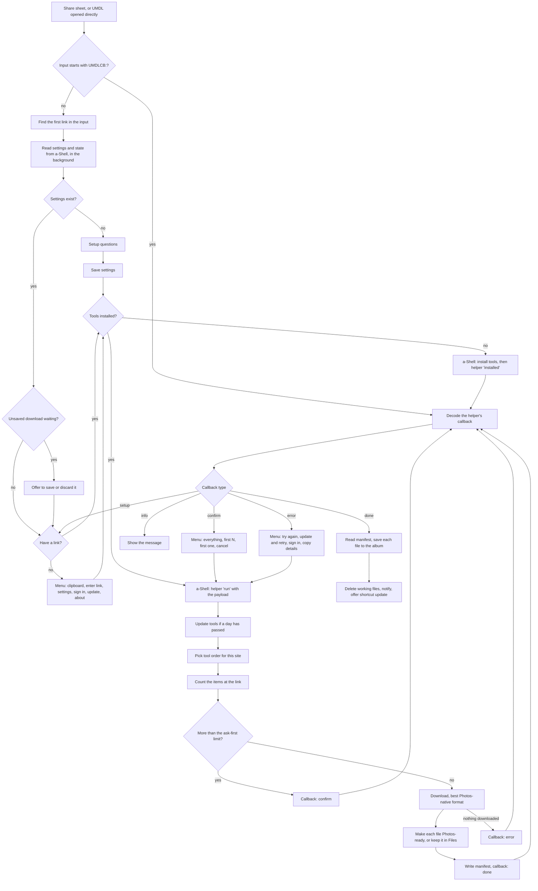

# Architecture

UMDL has two halves:

- **The shortcut** (`src/UMDL.cherri`) is everything you see in Shortcuts: reading the shared link, menus, settings, saving to Photos, notifications.
- **The helper** (`src/umdl.py`) runs inside a-Shell. It downloads with yt-dlp or gallery-dl, makes the result importable by Photos, and reports back.

They talk in one direction at a time. The shortcut starts the helper with a command line. The helper answers by opening a `shortcuts://` URL that runs the shortcut again with the result as its input.

## Flow



## Why a-Shell opens

a-Shell's Shortcuts actions run commands in two ways. "In extension" runs in the background and returns the output, but with tight memory and no Python. "In app" opens a-Shell and has the full environment.

UMDL uses the background mode for small things: reading settings, writing settings, deleting working files, checking the version file. Downloads need Python, so they open the app. iOS suspends an app that leaves the foreground, which is why a-Shell has to stay in front until the helper hands back.

## The payload (shortcut to helper)

A JSON object, base64-encoded so it survives a-Shell's command line whatever the link contains:

```
python umdl.py run <base64 JSON>
```

| Field | Meaning |
|---|---|
| `v` | Shortcut version |
| `p` | Protocol number |
| `name` | The shortcut's name, used for the callback |
| `url` | The link (or the shared text containing it) |
| `mode` | `auto` (ask above the limit), `all`, `limit`, `first` |
| `limit` | Item count for `mode: limit` |
| `force_update` | `1` to upgrade the tools before downloading |
| `cfg` | The settings: `album`, `threshold`, `convert`, `after` |

Other commands take the same payload: `installed`, `update`, `doctor`, `logout`.

## The callback (helper to shortcut)

```
shortcuts://run-shortcut?name=UMDL&input=text&text=UMDLCB:<base64 JSON>
```

Every callback includes `cfg`, echoed from the payload, so the shortcut does not need a second trip to a-Shell to know the album.

| `t` | Other fields | The shortcut then |
|---|---|---|
| `done` | `m` manifest path, `np` Photos count, `nk` kept-in-Files count, `nf` failed count, `title`, `up` newer release if any | Saves and notifies |
| `confirm` | `url`, `n` item count or empty when only "more than" is known, `thr`, `title` | Asks how much to download |
| `error` | `kind`, `msg`, `url` | Explains and offers fixes |
| `setup` | `url`, `ver` | Continues with the link, or says it is ready |
| `info` | `title`, `msg` | Shows the message |

Error kinds: `auth`, `network`, `gone`, `unsupported`, `drm`, `install`, `nolink`, `unknown`.

The file list is not in the callback. It is in the manifest (`jobs/<id>/manifest.json`), which the shortcut reads with a-Shell's "Get File", so a 500-item download does not need a 500-item URL.

## Files in a-Shell

Everything is under `~/Documents/UMDL`, visible in the Files app as *a-Shell › UMDL*.

| Path | Purpose |
|---|---|
| `umdl.py` | The helper |
| `env/` | Python virtual environment with yt-dlp and gallery-dl |
| `config.b64` | Settings, as base64 JSON |
| `state.json` | When the tools and the version file were last checked |
| `jobs/<id>/` | Working folder for one link. `<id>` is derived from the link, so sharing the same link again resumes |
| `jobs/<id>/out/` | Finished files with plain names (`001.mp4`) |
| `jobs/<id>/manifest.json` | What to save to Photos and what was kept |
| `pending` | Path of a manifest that has not been saved to Photos yet |
| `last.b64` | The payload of a download in progress; left behind only if it was interrupted |
| `last.log` | Log of the last run |
| `Saved/` | Files Photos cannot hold |

## Quality

yt-dlp is given this preference list, first match wins:

1. Best video in H.264 or HEVC, plus best AAC-family audio
2. Best single file with both
3. Best H.264 or HEVC video, plus any audio
4. Best H.264 or HEVC single file
5. Best MP4 or MOV whose codecs the site does not state
6. Best of anything, video then audio-only

After download every video is inspected with ffprobe, because what a site says and what it serves can differ:

| Found | Action |
|---|---|
| H.264 or HEVC, compatible audio, MP4 or MOV | Used as is |
| Right video codec, wrong container or audio | Rewrapped; video is copied, audio re-encoded only if needed |
| HEVC tagged `hev1` | Retagged `hvc1`, which Apple players require |
| Any other video codec | Converted with the hardware H.264 encoder if the setting allows, with a software fallback; otherwise kept in Files |
| No video stream | Kept in Files |

## Which tool goes first

- A site known for image or mixed posts (X, Instagram, Reddit, Bluesky, Imgur, Pixiv and others): gallery-dl, then yt-dlp.
- Any other site yt-dlp has an extractor for: yt-dlp, then gallery-dl if it also knows the site.
- A site only gallery-dl knows: gallery-dl, then yt-dlp's generic extractor.
- Neither: yt-dlp's generic extractor, which looks for media in the page.

The second tool runs only if the first produced nothing. If both fail, the first tool's error is the one shown.

## Staying current

- **Tools**: upgraded with pip once a day, and on demand.
- **Helper**: once a day the helper reads `version.json` from this repository. If `helper` is newer and `protocol` matches, it downloads the new `src/umdl.py`, checks that it compiles, and swaps it in for the next run.
- **Shortcut**: the same check notes a newer `shortcut` version, and the shortcut offers the release page after the next download.

Bump `protocol` only when the payload or callback changes incompatibly. A helper will not update itself across a protocol change, so an old shortcut keeps a helper it can talk to.

## Things that look odd but are deliberate

- **File names are `001.mp4`, not titles.** a-Shell has no fork/exec, so commands are passed as one string. Names without spaces or symbols cannot be mis-parsed. Titles are restored for files kept in Files.
- **The shortcut is linear, with flags.** Shortcuts has no functions or loops to speak of. Each section runs if its flag is set, and shared steps (the album question, saving settings, launching a-Shell) appear once near the end.
- **"Open App" then a one-second wait before each foreground command.** Copied from SW-DLT, where it makes the hand-off to a-Shell reliable.
- **Dictionary conversions are guarded.** Shortcuts stops with an error if asked to turn non-JSON text into a dictionary, so anything that came over the network or from disk is checked for an expected key first.
