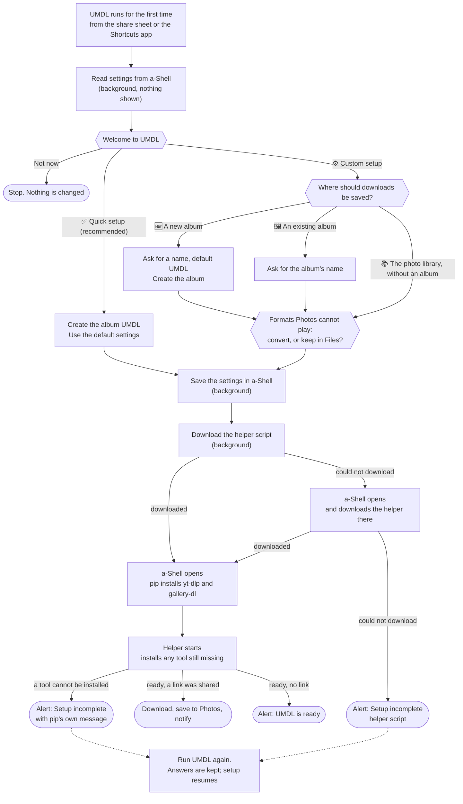

# Behaviour

Every screen UMDL can show, what leads to it, and what each choice does. This is the specification the shortcut is tested against: each row names the test that pins it down, and `tests/test_behavior_doc.py` fails if the shortcut shows a menu item or alert that is not described here.

Labels are written exactly as they appear. Tests are in `tests/test_shortcut_flow.py`, named here by class and then test.

- [How a run starts](#how-a-run-starts)
- [First run](#first-run)
- [Sharing a link](#sharing-a-link)
- [Large downloads](#large-downloads)
- [When a download fails](#when-a-download-fails)
- [Unsaved and interrupted downloads](#unsaved-and-interrupted-downloads)
- [Opening UMDL from the Shortcuts app](#opening-umdl-from-the-shortcuts-app)
- [Status](#status)
- [Settings](#settings)
- [What UMDL asks a-Shell to do](#what-umdl-asks-a-shell-to-do)
- [Prompts that come from iOS](#prompts-that-come-from-ios)
- [What the tests can and cannot show](#what-the-tests-can-and-cannot-show)

## How a run starts

| Started by | UMDL receives | First thing shown |
|---|---|---|
| Share sheet, and the shared item contains a link | The link, or text with a link in it | Nothing. a-Shell opens and downloads. See [Sharing a link](#sharing-a-link) |
| Share sheet, shared text has no link | Text | The [main menu](#opening-umdl-from-the-shortcuts-app) (`OneTap.test_shared_text_without_a_link_opens_the_main_menu`) |
| Shortcuts app, Home Screen, widget, Siri | Nothing | The main menu |
| The helper in a-Shell, when it finishes | `UMDLCB:` and a result | Depends on the result: saved, a question, or an error |
| The helper could not be downloaded | `UMDL-HELPER-MISSING` | The alert **Setup incomplete** |

A run that is not a result from the helper always does these in order, and each step is skipped when it does not apply:

1. Reads settings and state from a-Shell in the background. Nothing is shown.
2. No settings: the [welcome screen](#first-run).
3. A finished download is waiting: the [unsaved download prompt](#unsaved-and-interrupted-downloads).
4. No link: the [main menu](#opening-umdl-from-the-shortcuts-app).
5. Opens a-Shell with the request.

## First run

UMDL counts a run as a first run when a-Shell holds no readable settings. That covers a new install, a reset, a deleted a-Shell, and a damaged settings file.



### Welcome

> **Welcome to UMDL**
>
> UMDL saves shared posts and videos to Photos at the best quality your library can play. Downloads run on this device, in the a-Shell app.
>
> Quick setup saves to a new album named UMDL and installs the download tools. It takes about two minutes and needs an internet connection.

| Choice | Result | Test |
|---|---|---|
| ✅ Quick setup (recommended) | Creates the album **UMDL**, saves the default settings, installs everything, and downloads the shared link if there was one. No further questions | `Onboarding.test_quick_setup_from_the_share_sheet_is_one_tap_and_downloads` |
| ⚙️ Custom setup | Asks the two questions below, then continues exactly as quick setup does | `Onboarding.test_custom_setup_asks_album_then_conversion` |
| Not now | Stops. Nothing is created in Photos or a-Shell. The welcome screen appears again next time | `Onboarding.test_declining_setup_changes_nothing` |

The defaults are: album **UMDL**, ask before downloading more than **10** items, **convert** formats Photos cannot play, and **show a notification** when finished.

### Custom setup: where to save

> Where should downloads be saved?

| Choice | Follow-up | Result | Test |
|---|---|---|---|
| 🆕 A new album | "Name for the new album", filled in with `UMDL` | Creates the album. An empty name becomes `UMDL` | `Onboarding.test_custom_setup_asks_album_then_conversion`, `Onboarding.test_an_empty_album_name_falls_back` |
| 🖼️ An existing album | "Enter the album name exactly as Photos shows it" | Uses that album; nothing is created. An empty name means no album | `Onboarding.test_custom_setup_with_an_existing_album_or_none` |
| 📚 The photo library, without an album | None | Saves to the library only | `Onboarding.test_custom_setup_with_an_existing_album_or_none` |

### Custom setup: formats Photos cannot play

> UMDL downloads the best quality that Photos can play. When a site only offers a format Photos cannot play, what should happen?

| Choice | Result |
|---|---|
| 🎞️ Convert it for Photos (slower) | The video is converted on the device, then saved to Photos |
| 📁 Keep the original in Files | The file is kept in the Files app, under *a-Shell › UMDL › Saved* |

### How setup ends

| Situation | Shown | Test |
|---|---|---|
| A link was shared | The download runs and is saved, exactly as in [Sharing a link](#sharing-a-link). No "ready" message | `Onboarding.test_quick_setup_from_the_share_sheet_is_one_tap_and_downloads` |
| No link | Alert **UMDL is ready**: "Setup is complete. To download, share a post or video to UMDL from any app. To change settings, open UMDL from the Shortcuts app." | `Onboarding.test_quick_setup_opened_from_the_app_installs_and_reports_ready` |
| The helper script cannot be downloaded | Alert **Setup incomplete**: "UMDL could not download its helper script. Check the internet connection, then run UMDL again." | `Onboarding.test_no_connection_during_setup_is_reported_and_the_next_run_finishes` |
| The helper cannot be downloaded in the background, but can in the app | Nothing extra. a-Shell downloads it before continuing | `Onboarding.test_helper_is_downloaded_in_the_app_when_the_background_cannot` |
| yt-dlp or gallery-dl cannot be installed | Alert **Setup incomplete**: "The download tools could not be installed.", then the reason pip gave, then "Check the internet connection, then run UMDL again." | `Onboarding.test_tools_that_fail_to_install_are_reported_and_retried_next_time` |

After **Setup incomplete**, running UMDL again does not repeat the questions. The settings were saved before anything was downloaded, so the next run goes straight to whatever was missing.

Setup never shows the unsaved download prompt (`Onboarding.test_setup_never_reports_an_unsaved_download`).

### Updating from 1.0

Installing a new version of the shortcut over an old one keeps the settings. The first run after the update downloads the matching helper, removes the Python environment 1.0 created, and continues with what was asked (`Onboarding.test_upgrade_from_1_0_refetches_the_helper_and_removes_the_old_environment`).

## Sharing a link

The path UMDL exists for. Once setup is done it asks nothing (`OneTap.test_download_asks_nothing`).

1. The first link in the shared item is used, wherever it sits in the text (`OneTap.test_link_is_pulled_out_of_shared_text`).
2. a-Shell opens and shows progress.
3. Shortcuts returns to the front, saves each file to Photos, and deletes the working copies.
4. A notification reports the result.
5. If the setting says so, Photos opens (`OneTap.test_open_photos_when_finished`).

### The notification

The title is the post's title, or `UMDL` when the site gives none.

| Result | Text | Test |
|---|---|---|
| One item, album set | Saved to the *name* album. | `OneTap.test_download_asks_nothing`, `OneTap.test_awkward_titles_and_album_names_survive` |
| One item, no album | Saved to Photos. | `OneTap.test_no_album_saves_to_the_library` |
| Several items | Saved *N* items to the *name* album. | `OneTap.test_gallery_post_saves_every_image` |
| Nothing could go to Photos | No items could be added to Photos. | `OneTap.test_audio_is_kept_in_files` |
| Some files were kept in Files | A second line: *N* kept in Files, under a-Shell, UMDL, Saved. | `OneTap.test_audio_is_kept_in_files` |
| A file is over 1 GB | It is kept in Files, with a further line: *N* too large to pass to Photos (over 1 GB). | `OneTap.test_file_too_large_to_hand_over_is_kept_in_files` |
| Some items failed | A further line: *N* could not be downloaded. | `OneTap.test_partial_download_saves_what_arrived_and_says_what_did_not` |

### After the notification

| Situation | Shown | Test |
|---|---|---|
| A newer UMDL has been released | "UMDL *new* is available. The installed version is *current*." with **⬇️ Get the update** (opens the release page) and **Later** | `OneTap.test_newer_release_is_offered_after_the_download`, `OneTap.test_declining_the_update_ends_quietly` |
| The shortcut and the helper are different versions | "This copy of UMDL is out of date and cannot continue." with **⬇️ Get the latest version** and **Cancel**. Shown in place of the download | `OneTap.test_helper_from_another_version_is_reported_as_out_of_date` |

Two things happen without being shown:

- A download tool that has gone missing is installed again before the download (`OneTap.test_tools_removed_behind_umdls_back_are_reinstalled_on_the_way`), including when pip installs to a folder Python was not searching (`OneTap.test_tools_installed_where_python_is_not_looking_are_found`).
- A result UMDL cannot read is ignored, and the run continues as if nothing had been shared (`OneTap.test_unreadable_callback_falls_back_to_the_main_menu`).

## Large downloads

When a link holds more items than the limit in Settings (10 unless changed), UMDL stops before downloading and asks.

> *Title of the playlist or profile*
>
> This link contains 37 items.

When the site does not say how many, the text is "This link contains more than 10 items." (`LargeDownloads.test_unknown_size_says_more_than`).

| Choice | Result | Test |
|---|---|---|
| ⬇️ Download all | Downloads every item | `LargeDownloads.test_download_all_first_only_and_cancel` |
| ⬇️ Download the first 10 | Downloads up to the limit. The number shown is the limit | `LargeDownloads.test_more_than_ten_items_asks_then_limits` |
| ⬇️ Download the first item only | Downloads one | `LargeDownloads.test_download_all_first_only_and_cancel` |
| Cancel | Stops. Nothing is downloaded | `LargeDownloads.test_download_all_first_only_and_cancel` |

A link at or under the limit downloads without asking (`LargeDownloads.test_threshold_setting_is_respected`).

## When a download fails

> **Download failed**
>
> *The reason the site or the tool gave*
>
> *What to do about it*

The last line depends on the kind of failure (`Errors.test_each_kind_of_failure_gets_its_own_advice`, `Errors.test_error_menu_explains_and_cancels`):

| Kind of failure | Advice shown |
|---|---|
| The post needs an account | This post appears to require an account. Sign in to the site, then try again. |
| No connection | Check the internet connection, then try again. |
| Removed, private or region-locked | The post may be private, removed, or unavailable in your region. |
| Copy-protected | This media is copy-protected and cannot be downloaded. |
| Site not recognised | This site may not be supported. |
| Anything else | Updating the download tools resolves most failures. |

| Choice | Result | Test |
|---|---|---|
| 🔄 Try again | Runs the same download again. Parts already downloaded are reused | `Errors.test_try_again_succeeds_once_the_site_recovers` |
| 🛠️ Update tools and try again | Upgrades yt-dlp and gallery-dl first, then downloads | `Errors.test_update_tools_and_try_again` |
| 🔑 Sign in to this site | Opens that site's sign-in page and confirms the sign-in. See [Sign in to a site](#sign-in-to-a-site) | `Errors.test_sign_in_from_a_failed_download_opens_that_sites_sign_in_page` |
| 📋 Copy error details | Copies the UMDL version, the link, the error and the end of the helper's log to the clipboard, for a bug report. A notification confirms: "Error details copied to the clipboard." | `Errors.test_error_details_can_be_copied_with_the_log` |
| Cancel | Stops | `Errors.test_error_menu_explains_and_cancels` |

Two failures have their own screen in place of this menu: **Setup incomplete** (see [How setup ends](#how-setup-ends)) and **No link found**, "UMDL needs a web link. Share a post or video to UMDL, or copy its link first."

## Unsaved and interrupted downloads

**A download that finished but never reached Photos**, for example because Shortcuts was closed during the hand-back. The next run, however it starts, begins with:

> A download from an earlier run has not been saved to Photos.

| Choice | Result | Test |
|---|---|---|
| 💾 Save it now | Saves it and notifies. If this run also has a link, that download follows | `Recovery.test_unsaved_download_is_offered_again`, `Recovery.test_saving_an_earlier_download_then_continues_with_the_new_link` |
| 🗑️ Discard it | Deletes the files, then carries on with the run | `Recovery.test_unsaved_download_can_be_discarded` |

This prompt appears only when such a download exists. It is never shown during setup, or on a run that is itself delivering a download.

If the files of that download have since been removed from a-Shell, **Save it now** shows the alert **Nothing to save**, "The files of that download are no longer in a-Shell. Download the link again.", and the prompt does not return (`Recovery.test_unsaved_download_whose_files_are_gone_is_explained`).

**A download that was interrupted**, for example because a-Shell was closed. The main menu gains **Resume last download**, which repeats the request exactly as it was made (`Recovery.test_interrupted_download_can_be_resumed_from_the_menu`). Sharing the same link again has the same effect.

**A damaged settings file** is treated as no settings: the welcome screen appears (`Recovery.test_damaged_settings_file_restarts_setup_instead_of_failing`).

## Opening UMDL from the Shortcuts app

With no link to work on, UMDL shows its main menu straight away (`MainMenu.test_opening_from_the_app_goes_straight_to_the_main_menu`). Each row has an icon, a title and a line of detail.

| Item | Detail line | Result | Test |
|---|---|---|---|
| Download from clipboard | Uses the most recently copied link | Downloads the first link on the clipboard. With no link there: alert **No link found**, "The clipboard does not contain a link. Copy the link to a post or video, then try again." | `MainMenu.test_download_from_clipboard`, `MainMenu.test_clipboard_without_a_link_is_explained` |
| Enter a link | Type or paste a link to a post or video | Asks "Link to download" with the URL keyboard, then downloads. Anything that is not a link: alert **No link found**, "The text entered is not a web link." | `MainMenu.test_enter_a_link`, `MainMenu.test_entering_something_that_is_not_a_link` |
| Resume last download | Continues the download that was interrupted | Listed only when a download was interrupted | `Recovery.test_interrupted_download_can_be_resumed_from_the_menu` |
| Settings | Album and download options | Opens [Settings](#settings) | `Settings.test_settings_menu_shows_current_values` |
| Sign in to a site | Required for private or age-restricted posts | See below | `MainMenu.test_sign_in_is_confirmed_once_the_site_has_stored_it` |
| Status | Sign-ins, versions and logs | Opens [Status](#status) | `MainMenu.test_status_shows_sign_ins_versions_and_storage` |
| Update tools | Installs the latest yt-dlp and gallery-dl | a-Shell upgrades the tools, then an alert **Download tools updated** lists the installed versions. If the upgrade fails the title is **The update could not be completed** | `MainMenu.test_update_tools_reports_back` |
| About UMDL | Version *x*. Updates and project page | See below | `MainMenu.test_about_project_page_and_done` |

Dismissing the menu stops the shortcut.

### Sign in to a site

> Choose a site to sign in to.
>
> The sign-in is stored on this device, inside a-Shell. Status shows which sites are signed in.

Choices: **Instagram**, **X (Twitter)**, **Reddit**, **TikTok**, **Facebook**, **Another site**. "Another site" asks for the "Address of the site's sign-in page"; text that is not a web address gives the alert **Sign in**, "The text entered is not a web address."

Then the alert **Sign in** explains what follows: "a-Shell will open the sign-in page. Sign in as usual. UMDL returns here and confirms as soon as the sign-in has been saved, usually within a few seconds. If it does not, swipe right from the left edge of the screen to close the page, then check Status in the UMDL menu."

a-Shell opens the site's sign-in page in its own browser, and the helper watches a-Shell's cookie store. UMDL does not see what is typed, and never reads a cookie's value, only which site it belongs to and its name. yt-dlp and gallery-dl read the same store, so nothing is copied anywhere.

| What happens | Shown | Test |
|---|---|---|
| The site stores a sign-in | Shortcuts returns to the front with the alert **Signed in to** *site*: "The sign-in is saved on this device, inside a-Shell. UMDL uses it for *site* links from now on." | `MainMenu.test_sign_in_is_confirmed_once_the_site_has_stored_it` |
| The site was already signed in | The page is not opened. Alert **Already signed in to** *site*, which also says how to switch accounts | `MainMenu.test_signing_in_again_reports_the_existing_sign_in` |
| No sign-in appears within 10 minutes | Alert **Sign-in not confirmed**: "No sign-in to *site* was found after 10 minutes. If you did sign in, open Status from the UMDL menu to check. Some sites do not allow signing in from an app's built-in browser." | `MainMenu.test_sign_in_that_was_not_completed_says_so` |
| A site that is not in the list | The address entered is opened as it is. A sign-in is recognised by a session cookie for that site, and confirmed under the site's domain name | `MainMenu.test_sign_in_to_another_site` |

For the five listed sites "signed in" means the site's own session cookie is present and has not expired. Visiting a site without signing in does not count.

### About UMDL

> **UMDL 1.2.0**
>
> A free, open-source media downloader.
> Powered by yt-dlp, gallery-dl and a-Shell.

| Choice | Result | Test |
|---|---|---|
| 🔄 Check for a new version | Up to date: alert **UMDL is up to date**. Newer release: "UMDL *new* is available…" and its release notes, with **⬇️ Get the update** and **Later**. No connection: alert **Update check**, "GitHub could not be reached. Check the internet connection, then try again." | `MainMenu.test_check_for_new_version` |
| 🌐 Open the project page | Opens the repository on GitHub | `MainMenu.test_about_project_page_and_done` |
| Done | Closes the menu | `MainMenu.test_about_project_page_and_done` |

## Status

**Status** in the main menu opens a-Shell for a few seconds, then shows the alert **UMDL status**. It answers "is everything in place?" and "am I signed in?" (`MainMenu.test_status_shows_sign_ins_versions_and_storage`).

```
UMDL 1.2.0, helper 1.2.0
a-Shell 2.3.0 (512)
Python 3.11.9
yt-dlp 2026.11.20
gallery-dl 1.31.2
ffmpeg 6.1
Tools last updated: 25 Nov 17:20

Sign-ins
Instagram: signed in
X (Twitter): not signed in
Reddit: signed in
TikTok: not signed in
Facebook: not signed in
Other sites that may be signed in: example.org

Storage
Working files: 0 bytes
Kept in Files: 2 items
Unsaved download: none
Free space: 41.3 GB

Checks
Download tools: ready
GitHub: reachable
Last download: 25 Nov 17:36, failed (auth)
```

The version numbers above are examples. When nothing has ever been stored, the sign-in section reads "No sign-ins are stored."

After the alert:

> Copy the status and the last log to the clipboard?
>
> Useful when reporting a problem.

| Choice | Result | Test |
|---|---|---|
| 📋 Copy status and log | Copies the status text and the end of the helper's log of the last download. A notification confirms: "Status and log copied to the clipboard." Works when there is no log yet | `MainMenu.test_status_and_log_can_be_copied`, `MainMenu.test_copying_status_before_any_download_does_not_fail` |
| Done | Closes the menu | `MainMenu.test_status_shows_sign_ins_versions_and_storage` |

The log holds the link, which tool was tried, and the error each tool reported. It holds no cookies and no passwords.

## Settings

Each row shows its current value as the detail line (`Settings.test_settings_menu_shows_current_values`). A change is saved at once and confirmed by the notification "Settings saved." Settings never open a-Shell, except **Forget saved sign-ins**.

| Item | Detail line | Changing it | Test |
|---|---|---|---|
| Save to | The album's name, or "Photo library. No album" | The same question as [custom setup](#custom-setup-where-to-save) | `Settings.test_change_album_conversion_and_finish_action` |
| Ask before large downloads | When a link contains more than *N* items | Asks for a number, filled in with the current one. Accepts 1 to 9999. Anything else: alert **Not saved**, "Enter a whole number from 1 to 9999." | `Settings.test_change_threshold`, `Settings.test_reject_a_bad_threshold` |
| Unsupported video formats | "Convert for Photos" or "Keep the original in Files" | The same question as [custom setup](#custom-setup-formats-photos-cannot-play) | `Settings.test_change_album_conversion_and_finish_action` |
| When a download finishes | "Show a notification" or "Open Photos" | **🔔 Show a notification** or **🖼️ Open Photos**. A notification is shown either way | `Settings.test_change_album_conversion_and_finish_action` |
| Forget saved sign-ins | Signs out of every site | a-Shell deletes its stored cookies, then an alert **Sign-ins removed**. If that fails: **The sign-ins could not be removed** | `Settings.test_forget_sign_ins` |
| Reset UMDL | Removes the helper and all settings | Asks first, see below | `Settings.test_reset_removes_everything_and_can_be_cancelled` |

### Reset UMDL

> Remove UMDL's helper, settings and working files from a-Shell?
>
> Photos and the shortcut itself are not affected. Files kept under a-Shell, UMDL, Saved are deleted.

**🗑️ Reset UMDL** deletes UMDL's folder in a-Shell and shows the alert **UMDL was reset**. The next run is a first run. **Cancel** changes nothing. yt-dlp and gallery-dl stay installed in a-Shell; removing a-Shell removes them.

## What UMDL asks a-Shell to do

a-Shell runs commands for a shortcut in two ways. Background commands return their output without a-Shell appearing, but cannot run Python. Commands in the app open a-Shell.

| When | Where | Command |
|---|---|---|
| Start of every run that is not a result | Background | Print the settings file, the helper's version marker, and any unsaved or interrupted download |
| Settings saved | Background | Write `config.b64` |
| Before saving to Photos | Background | `cat` the list of files of that download |
| Each file to save | a-Shell's Get File action, as a copy | Hand one file to Shortcuts |
| Files saved to Photos, or discarded | Background | Delete that download's working folder |
| Copy error details, copy status and log | Background | `tail` the last 40 lines of the helper's log |
| Check for a new version | Background | `curl` this repository's `version.json` |
| Reset UMDL | Background | Delete `~/Documents/UMDL` |
| Helper missing, or from another version | Background | `curl` `src/umdl.py` from this repository, and record which shortcut version fetched it |
| The same, when the background download fails | In the app | The same download, typed into the a-Shell window |
| After the helper was fetched | In the app | `pip install --upgrade yt-dlp gallery-dl`, before the helper starts |
| Download, setup, update tools, status, sign in, forget sign-ins | In the app | `python umdl.py <command> <request>` |
| Sign in | By the helper | `internalbrowser <address>`, then it watches the cookie store |

Every background command is run with a-Shell's "continue after an error" option, and every Get File asks for a copy. Without either, a-Shell reports a failed action and Shortcuts stops with "There was a problem running the shortcut", naming neither the action nor the reason (`Hygiene.test_background_commands_survive_a_failing_command`, `Hygiene.test_get_file_always_asks_for_a_copy`).

The helper also keeps the tools current by itself: it installs any that are missing, upgrades them once a day, and replaces itself when this repository publishes a newer helper for the same protocol.

## Prompts that come from iOS

These are shown by iOS, not by UMDL, the first time each permission is needed. Choosing **Always Allow** stops them. The simulator cannot show them.

- Allow UMDL to run actions from a-Shell
- Allow UMDL to save to Photos, and to create an album
- Allow UMDL to send notifications
- Allow UMDL to open another app or a link
- Allow UMDL to read the clipboard, for **Download from clipboard**
- Allow a-Shell to run the UMDL shortcut, when the helper hands back

A first run from the share sheet can therefore need several taps on **Allow** before the single tap on **Quick setup** takes effect. After that, sharing a link needs none.

## What the tests can and cannot show

The flow tests run the compiled shortcut, action by action, in `tests/shortcut_sim.py`, against the real helper script. yt-dlp, gallery-dl, pip and curl are replaced by stand-ins in `tests/fakes`, so a test can stage an offline device, a failed install, a playlist of any size, or a site that returns an error.

That shows the logic is right. It cannot show how iOS behaves. Two device tests have each found something the simulator had wrong, and each is now part of the simulator, so the old build fails in it the way it failed on the phone:

| Found on a device | What it caused | Now |
|---|---|---|
| An empty text counts as having a value in an **If** action (1.0.0) | A false "unsaved download" prompt on every run, and no main menu | The shortcut compares with `[]` instead; `Hygiene.test_no_condition_relies_on_has_any_value` |
| On iOS 27.2, a-Shell's **Get File** stops the shortcut unless it is asked for a copy ([a-Shell issue 1138](https://github.com/holzschu/a-shell/issues/1138)) (1.1.0) | "There was a problem running the shortcut" after every successful download | Get File always asks for a copy; `Hygiene.test_get_file_always_asks_for_a_copy` |

Confirmed on a device so far:

- Setup, the download tools installing, and a download running in a-Shell.
- The main menu and the menus under it.
- The helper's result reaching the shortcut, the failed-download menu, and **Copy error details**.
- The sign-in page opening in a-Shell.

Not yet confirmed on a device, and so the first things to check ([device checklist](BUILDING.md#device-checklist)):

- Saving to the album and the notification. This is the step the Get File fault blocked.
- The sign-in confirmation. It depends on a-Shell writing its cookie store while the page is still open; if it writes later, the result is **Sign-in not confirmed** and Status shows the sign-in afterwards.
- Status, and copying the log.
