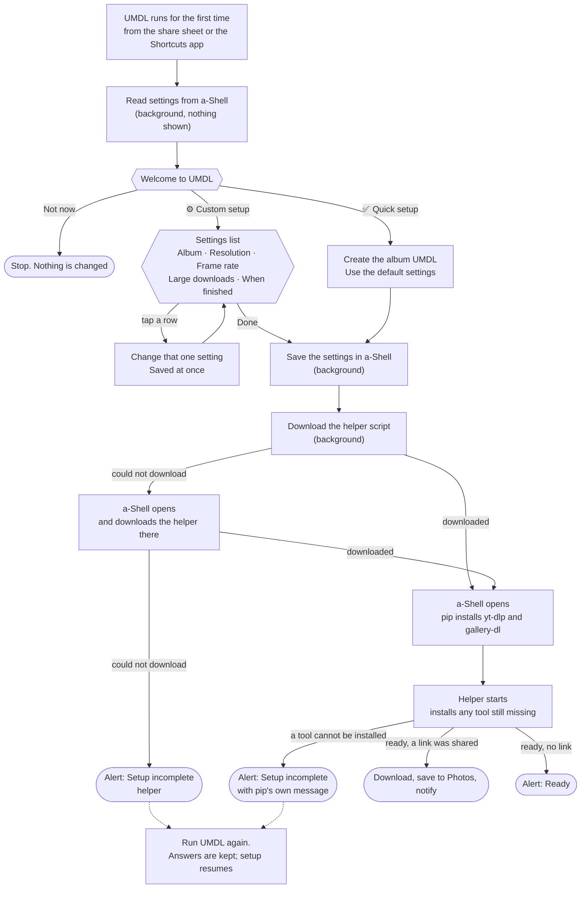
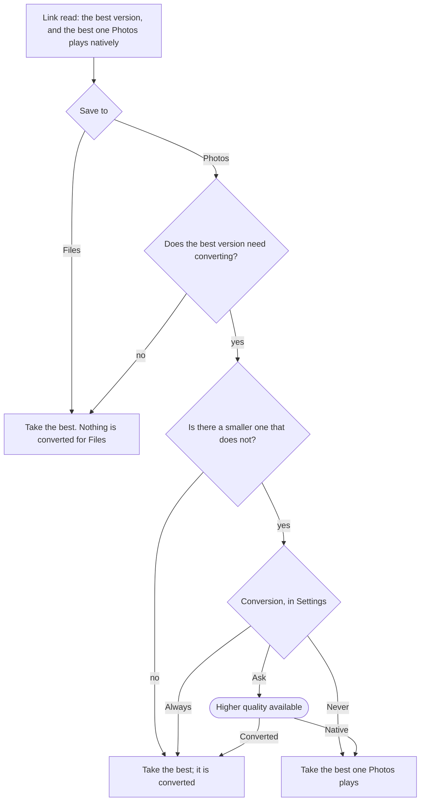
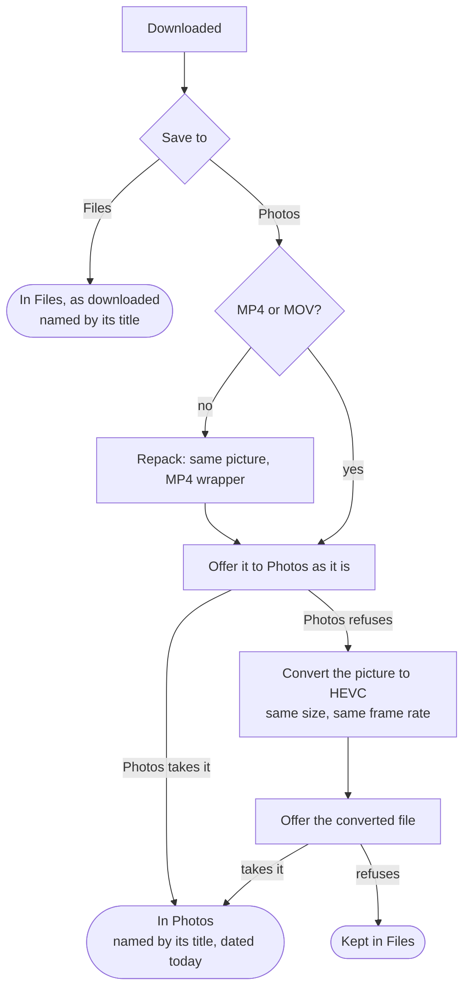
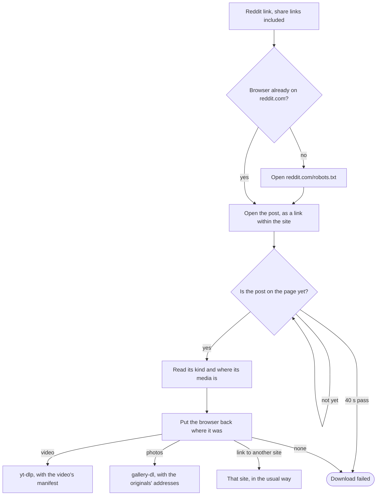

# Behaviour

Every screen UMDL can show, what leads to it, and what each choice does. This is the specification the shortcut is tested against: each row names the test that pins it down, and `tests/test_behavior_doc.py` fails if the shortcut shows a menu item or alert that is not described here.

Labels are written exactly as they appear. Tests are in `tests/test_shortcut_flow.py`, named here by class and then test.

- [How a run starts](#how-a-run-starts)
- [First run](#first-run)
- [Sharing a link](#sharing-a-link)
- [Which version is downloaded](#which-version-is-downloaded)
- [Higher quality available](#higher-quality-available)
- [Saving](#saving)
- [Saving to Files](#saving-to-files)
- [When a file stays in Files](#when-a-file-stays-in-files)
- [Reddit](#reddit)
- [Large downloads](#large-downloads)
- [When a download fails](#when-a-download-fails)
- [Interrupted downloads](#interrupted-downloads)
- [Opening UMDL from the Shortcuts app](#opening-umdl-from-the-shortcuts-app)
- [Status](#status)
- [Settings](#settings)
- [What UMDL asks a-Shell to do](#what-umdl-asks-a-shell-to-do)
- [Prompts that come from iOS](#prompts-that-come-from-ios)
- [What the tests can and cannot show](#what-the-tests-can-and-cannot-show)

## How a run starts

| Started by | UMDL receives | First thing shown |
|---|---|---|
| Share sheet, and the shared item contains a link | The link, or text with a link in it | Nothing. a-Shell opens and downloads. See [Sharing a link](#sharing-a-link) |
| Share sheet, shared text has no link | Text | The [main menu](#opening-umdl-from-the-shortcuts-app) (`OneTap.test_shared_text_without_a_link_opens_the_main_menu`) |
| Shortcuts app, Home Screen, widget, Siri | Nothing | The main menu |
| The helper in a-Shell, when it finishes | `UMDLCB:` and a result | Depends on the result: saved, a question, or an error |
| The helper could not be downloaded | `UMDL-HELPER-MISSING` | The alert **Setup incomplete** |

A run that is not a result from the helper always does these in order, and each step is skipped when it does not apply:

1. Reads settings and state from a-Shell in the background. Nothing is shown.
2. No settings: the [welcome screen](#first-run).
3. A finished download is waiting: the [unsaved download prompt](#unsaved-and-interrupted-downloads).
4. No link: the [main menu](#opening-umdl-from-the-shortcuts-app).
5. Opens a-Shell with the request.

## First run

UMDL counts a run as a first run when a-Shell holds no readable settings. That covers a new install, a reset, a deleted a-Shell, and a damaged settings file.



### Welcome

> **Welcome to UMDL**
>
> Saves shared posts and videos at the best quality.
>
> Setup takes two minutes.

| Choice | Result | Test |
|---|---|---|
| ✅ Quick setup | Creates the album **UMDL**, saves the default settings, installs everything, and downloads the shared link if there was one. No further questions | `Onboarding.test_quick_setup_from_the_share_sheet_is_one_tap_and_downloads` |
| ⚙️ Custom setup | Opens the [Settings](#settings) list so anything can be changed first, then continues exactly as quick setup does | `Onboarding.test_custom_setup_is_the_settings_list_then_the_same_install` |
| Not now | Stops. Nothing is created in Photos or a-Shell. The welcome screen appears again next time | `Onboarding.test_declining_setup_changes_nothing` |

The defaults are: album **UMDL**, resolution and frame rate **Best**, ask above **10** items, and **Notify** when finished.

### Custom setup

Custom setup is the Settings list itself, with two differences: there is no **Reset** row, and the last row, **Done**, reads "Install". Every row works as described under [Settings](#settings).

| Situation | Result | Test |
|---|---|---|
| Rows are changed, then **Done** | Those values are saved and used by the download that follows | `Onboarding.test_custom_setup_is_the_settings_list_then_the_same_install` |
| **Done** with nothing changed | The same as quick setup, including the album **UMDL** | `Onboarding.test_custom_setup_left_as_it_is_equals_quick_setup` |
| **Album** set to a name, or to the library | That is where downloads go. Album that does not exist yet is made by the first download saved to it | `Onboarding.test_custom_setup_with_an_existing_album_or_none` |
| Album with an empty name | The name becomes `UMDL` | `Onboarding.test_an_empty_album_name_falls_back` |

### How setup ends

| Situation | Shown | Test |
|---|---|---|
| A link was shared | The download runs and is saved, exactly as in [Sharing a link](#sharing-a-link). No "ready" message | `Onboarding.test_quick_setup_from_the_share_sheet_is_one_tap_and_downloads` |
| No link | Alert **Ready**: "Share a post to UMDL to save it. Settings: open UMDL in Shortcuts." | `Onboarding.test_quick_setup_opened_from_the_app_installs_and_reports_ready` |
| The helper cannot be downloaded | Alert **Setup incomplete**: "Helper download failed. Check the connection and run UMDL again." | `Onboarding.test_no_connection_during_setup_is_reported_and_the_next_run_finishes` |
| The helper cannot be downloaded in the background, but can in the app | Nothing extra. a-Shell downloads it before continuing | `Onboarding.test_helper_is_downloaded_in_the_app_when_the_background_cannot` |
| yt-dlp or gallery-dl cannot be installed | Alert **Setup incomplete**: "Tool install failed.", then the reason pip gave | `Onboarding.test_tools_that_fail_to_install_are_reported_and_retried_next_time` |

After **Setup incomplete**, running UMDL again does not repeat the questions. The settings were saved before anything was downloaded, so the next run goes straight to whatever was missing.

### Updating from an earlier version

Installing a new version of the shortcut over an old one keeps the settings. The first run after the update downloads the matching helper, removes the Python environment 1.0 created, and continues with what was asked (`Onboarding.test_upgrade_from_1_0_refetches_the_helper_and_removes_the_old_environment`). Settings saved by earlier versions are kept. The mode and conversion settings of 1.3 and 1.4 no longer exist and are ignored (`Settings.test_settings_saved_by_earlier_versions_are_read`, `Quality.test_settings_left_over_from_advanced_mode_are_ignored`).

## Sharing a link

The path UMDL exists for. Once setup is done it asks nothing (`OneTap.test_download_asks_nothing`), with one exception that a setting removes: [Higher quality available](#higher-quality-available).

1. The first link in the shared item is used, wherever it sits in the text (`OneTap.test_link_is_pulled_out_of_shared_text`).
2. a-Shell opens, downloads, and saves to Photos, or to Files if **Save to** says so. See [Saving](#saving) and [Saving to Files](#saving-to-files).
3. Shortcuts returns to the front with a notification.
4. If the setting says so, Photos opens (`OneTap.test_open_photos_when_finished`).

### The notification

The title is the post's title, or `UMDL` when the site gives none.

| Result | Text | Test |
|---|---|---|
| One item, album set | Saved to *name*. | `OneTap.test_download_asks_nothing`, `OneTap.test_awkward_titles_and_album_names_survive` |
| One item, no album | Saved to Photos. | `OneTap.test_no_album_saves_to_the_library` |
| Several items | Saved *N* items to the *name* album. | `OneTap.test_gallery_post_saves_every_image` |
| Nothing could go to Photos | Not saved to Photos. | `OneTap.test_audio_is_kept_in_files` |
| A video was converted | A further line naming the change: Converted VP9 → HEVC. | `Saving.test_a_file_photos_refuses_is_converted_and_saved` |
| Some files were kept in Files | A further line: *N* kept in Files. | `OneTap.test_audio_is_kept_in_files` |
| **Save to** is Files | Saved to Files. Or: *N* saved to Files. | `ToFiles.test_the_best_version_is_kept_as_downloaded_and_nothing_is_asked`, `ToFiles.test_several_items` |
| Photos could not be used at all | A last line giving the reason, for example: a-Shell has no Photos access. Allow it in Settings › a-Shell › Photos. | `Saving.test_when_photos_cannot_be_used_files_are_kept_and_the_reason_given` |
| Some items failed | A further line: *N* failed. | `OneTap.test_partial_download_saves_what_arrived_and_says_what_did_not` |

### After the notification

| Situation | Shown | Test |
|---|---|---|
| A newer UMDL has been released | "UMDL 1.9.0 available", "Installed: 1.8.0", with **⬇️ Update** (opens the release page) and **Later** | `OneTap.test_newer_release_is_offered_after_the_download`, `OneTap.test_declining_the_update_ends_quietly` |
| The shortcut and the helper are different versions | "UMDL is out of date." and the reason, with **⬇️ Update** and **Cancel**. Shown in place of the download | `OneTap.test_helper_from_another_version_is_reported_as_out_of_date` |

Three things happen without being shown:

- A download tool that has gone missing is installed again before the download (`OneTap.test_tools_removed_behind_umdls_back_are_reinstalled_on_the_way`), including when pip installs to a folder Python was not searching (`OneTap.test_tools_installed_where_python_is_not_looking_are_found`).
- A result UMDL cannot read is ignored, and the run continues as if nothing had been shared (`OneTap.test_unreadable_callback_falls_back_to_the_main_menu`).
- A Reddit link is read in a-Shell's browser, not by the tools. See [Reddit](#reddit).

## Which version is downloaded

The best one the site has. Two settings limit that, and nothing else has a say (`Quality.test_the_best_version_is_taken_and_nothing_is_asked`):

1. The largest picture, up to the **Resolution** limit. A site with nothing at or under the limit gives its smallest version above it. The limit is the short side, so a tall phone video counts by its width.
2. The highest frame rate, up to the **Frame rate** limit. Versions above this limit are passed over even when they are larger; if the site has nothing at or under it, the lowest rate is taken.
3. Between versions equal in both, the one that costs least to get into Photos: H.264 or HEVC, which go in as they are; then AV1, on a device whose chip reads it (`Quality.test_av1_is_taken_in_place_of_vp9_where_the_chip_reads_it`); then VP9. An HDR version is taken over a plain one of the same size. Sound is AAC where the site has it.

Step 3 never gives up size or smoothness: a 4K VP9 version is taken over a 1080p H.264 one. It applies to every site in the same way. Each limit works on its own (`Quality.test_each_limit_works_on_its_own`).

Photos takes neither AV1 nor VP9, so both are converted; the order between them is about how long that takes. An iPhone 15 Pro or later reads AV1 with its chip. No iPhone lets an app like a-Shell use its VP9 decoder: iOS keeps that for apps Apple has granted it to, YouTube's among them. On an iPhone 16 Pro Max, a 4K60 HDR AV1 video two minutes long was converted in two minutes; a 4K VP9 video was at 2% after several. **Status** says on its "AV1" line whether AV1 is taken.

YouTube is where this matters: above 1080p it offers only VP9 and AV1, and at 1080p and under it has H.264.

## Higher quality available

When the best version would have to be converted for Photos and a smaller one would not, UMDL asks which is wanted, unless **Conversion** in Settings has already answered. a-Shell reads the link, Shortcuts asks, and a-Shell carries on without reading the link again.



> **Higher quality available**
>
> *the title*

| Choice | Result | Test |
|---|---|---|
| 🎞️ 2160p60 · Converted | Downloads the best version; it is converted when saved. The link is not read a second time | `HigherQuality.test_the_question_names_both_versions_and_converted_is_one_tap` |
| ⚡ 1080p60 · Native | Downloads the best version Photos plays without converting | `HigherQuality.test_native_takes_the_best_photos_plays` |
| Cancel | Nothing is downloaded | `HigherQuality.test_cancel_downloads_nothing` |

The question explains nothing: the two buttons say what there is to know. The two sizes are those of the video in question; "HDR" follows the size when that version is HDR.

| Situation | Asked? | Test |
|---|---|---|
| **Conversion** is "Always" or "Never" | No. The setting is the answer | `HigherQuality.test_a_preference_in_settings_answers_in_advance` |
| The best version needs no converting, or nothing the site has plays as it is | No. There is nothing to choose between | `HigherQuality.test_nothing_is_asked_when_there_is_no_choice` |
| **Save to** is Files | No | `ToFiles.test_the_best_version_is_kept_as_downloaded_and_nothing_is_asked` |
| A playlist or a post with several videos | No. With "Never", each item is the best Photos plays; otherwise each is the best there is | `HigherQuality.test_a_list_of_many_follows_the_preference_and_never_asks` |
| A "convert" setting left by a version before 1.5 | Yes. It meant something else and counts as not set | `Quality.test_settings_left_over_from_advanced_mode_are_ignored` |

"Never" chooses between versions; it does not keep a video out of Photos. Where a site has only a format Photos cannot play, that is still converted.

## Saving



This is the only route to Photos. a-Shell is allowed to add to Photos, so the helper saves each file itself, from inside a-Shell. Nothing passes through Shortcuts (`Saving.test_nothing_ever_travels_through_shortcuts`), and a file that cannot go into Photos has one other place to end: Files.

| | | Test |
|---|---|---|
| Name | The post's title, or the name the file was uploaded under when the site gives no title. Characters a file name cannot hold are dropped. Several files with one title are numbered | `Saving.test_the_helper_saves_it_itself_under_its_title_dated_today`, `Saving.test_several_items_get_names_that_do_not_collide`, `Saving.test_a_video_joined_from_two_files_keeps_its_title` |
| Date | The day it was downloaded, not the day it was uploaded | `Saving.test_the_helper_saves_it_itself_under_its_title_dated_today` |
| Album | The album from Settings; with none, the library. A file Photos refuses does not cost the files after it their album | `Saving.test_no_album_saves_to_the_library`, `Saving.test_a_refused_file_does_not_cost_the_album` |
| Size | Any | |
| Formats | Photos decides. A file is offered as it is, and converted only if Photos refuses it | `Saving.test_photos_is_asked_first_and_a_file_it_takes_is_not_converted`, `Saving.test_a_file_photos_refuses_is_converted_and_saved` |
| Sound only, or not media | Kept in Files | `Saving.test_audio_is_still_kept_in_files` |

A conversion is always at the best quality: HEVC from the device's hardware encoder, the picture's size and frame rate unchanged, 10-bit and HDR colours kept, sound copied where Photos plays it. The encoder is given a bitrate well above the source's: 1.6 times for AV1, 1.3 times for VP9, and never under a floor for the size. If every encoder fails, the original is kept in Files.

While it runs, a-Shell shows what is being converted and how far it is, for example "Converting 2160p60 HDR AV1 + AAC  41%". The size is named after the 16:9 frame the picture fills, so a 3840×1920 video is 2160p, not "1920p". The notification names the change, and the log records the ffmpeg arguments and how long it took.

Writing HEVC is done by the device's hardware. Reading the source is too, where the hardware can: ffmpeg is asked to use it whenever it is built to. VP9 is the exception, read in software for the reason given under [Which version is downloaded](#which-version-is-downloaded), and that is what makes a VP9 conversion slow.

Nothing else a tool prints reaches the screen: warnings yt-dlp writes past its own logger go to the log (`Saving.test_warnings_the_tool_writes_past_its_logger_stay_off_the_screen`).

iOS pauses a-Shell when it is not on screen, so a conversion only moves while a-Shell is in front. Nothing is lost by leaving: see [Interrupted downloads](#interrupted-downloads).

The first save asks, once, to let a-Shell add to Photos. Saving to a named album needs fuller access than adding to the library; if only adding is allowed, files go to the library and the notification says "Saved to Photos."

## When a file stays in Files

With **Save to** set to Photos, Files is the one exception. A file kept there is in the Files app under *On My iPhone › a-Shell › UMDL › Saved*, under its title, and the notification counts it.

| Why | The notification adds | Test |
|---|---|---|
| It is sound only, or not a photo or video | Nothing more | `Saving.test_audio_is_still_kept_in_files` |
| Photos refused it, and the converted file too, or it could not be converted | Nothing more. The log has Photos' reason | |
| a-Shell is not allowed to add to Photos | a-Shell has no Photos access. Allow it in Settings › a-Shell › Photos. | `Saving.test_when_photos_cannot_be_used_files_are_kept_and_the_reason_given` |
| a-Shell stopped in the middle of a save last time | Saving to Photos stopped a-Shell last time (at "*step*"). Run Update tools to try again. | |
| This a-Shell cannot add to Photos, or Photos could not be reached | This version of a-Shell cannot add to Photos. Or: Photos unavailable (*error*). | |

Saving from a-Shell cannot be tried anywhere but on a device, so each step's name is noted before it is taken. If a-Shell stops in the middle, the next download finds the note and keeps its files in Files, with the fourth line above, in place of stopping a-Shell again. **Update tools** clears the note.

## Saving to Files

**Save to › 📁 Files** sends every download to the Files app, under *On My iPhone › a-Shell › UMDL › Saved*, and leaves Photos alone.

| | | Test |
|---|---|---|
| Version | The best there is. Nothing is asked | `ToFiles.test_the_best_version_is_kept_as_downloaded_and_nothing_is_asked` |
| Format | As downloaded. Nothing is repacked or converted, so nothing waits on a conversion. Whether the Files app can play it is up to iOS: H.264 and HEVC play; AV1 plays on a device whose chip reads it; VP9 may need another app, such as VLC | `ToFiles.test_a_format_photos_cannot_play_is_not_converted` |
| Name | The title, as in Photos | `ToFiles.test_the_best_version_is_kept_as_downloaded_and_nothing_is_asked` |
| Notification | Saved to Files. | `ToFiles.test_several_items` |
| **When finished** set to open | The Files app opens at that folder | `ToFiles.test_open_when_finished_shows_the_folder_in_files` |

The album is remembered while **Save to** is Files, and used again when it is set back (`Settings.test_save_to_files_and_back`).

## Reddit

In October 2026 Reddit closed the data pages that yt-dlp and gallery-dl read. They now answer "You've been blocked by network security" to everyone: on any network, signed in or not, even to a browser. What Reddit still serves is the post's own page, to a browser that runs its scripts.

a-Shell has such a browser, the one **Sign in** uses. For a Reddit link the helper opens the post there, as a visitor would, reads from the page where the photo or video is, and gives those addresses to the download tools. This is the only route for Reddit; the tools are not asked about the post.



The detour through `robots.txt` matters on a phone with the Reddit app: iOS hands a Reddit address to the app when it is opened from another site, and leaves it in the browser when it is a link within reddit.com. All of this happens inside a-Shell without the page being shown, and the browser is returned to whatever it was showing before (`RedditThroughTheBrowser.test_browser_is_returned_to_the_page_it_was_showing`).

| Post | Result | Test |
|---|---|---|
| Photo or gallery | The original images are saved, in the post's order. Avatars and pictures in comments are not | `RedditThroughTheBrowser.test_photo_post_is_saved_with_no_question`, `RedditThroughTheBrowser.test_single_image_is_fetched_once` |
| Video hosted by Reddit | Downloaded with sound by yt-dlp, named by the post's title | `RedditThroughTheBrowser.test_video_post_goes_to_yt_dlp_with_its_manifest` |
| Link to another site | Downloaded from that site in the usual way | `RedditThroughTheBrowser.test_post_that_links_elsewhere_is_downloaded_from_there` |
| Gallery over the ask-first limit | The [large download](#large-downloads) question, with the exact count | `RedditThroughTheBrowser.test_large_gallery_still_asks_first` |
| Reddit first shows a page that checks the browser | Waited through | `RedditThroughTheBrowser.test_the_page_is_waited_for_while_reddit_checks_the_browser` |
| Text post | [Download failed](#when-a-download-fails): No photo or video in this post. | `RedditThroughTheBrowser.test_post_without_media_and_a_browser_that_never_answers` |
| Reddit shows its block page to the browser | Download failed: Reddit blocked a-Shell's browser. | `RedditThroughTheBrowser.test_a_block_is_reported_as_reddits_and_not_blamed_on_the_account` |
| The post never appears | Download failed: Reddit did not show the post. When UMDL is not signed in to Reddit, "Sign in to Reddit." is added and the menu's advice is to sign in | `RedditThroughTheBrowser.test_a_post_reddit_does_not_show_points_to_signing_in_only_when_signed_out` |

The script that reads the page is run against saved pages in `tests/test_reddit_js.py`, and in the flow tests by a stand-in browser that executes it. Reddit cannot be opened from where the tests are written, so the pages are modelled on its markup as documented elsewhere, not captured.

Links to other sites never involve the browser (`RedditThroughTheBrowser.test_other_sites_never_involve_the_browser`). Addresses on Reddit's media hosts, `i.redd.it` and `v.redd.it`, go to the tools directly.

## Large downloads

When a link holds more items than the limit in Settings (10 unless changed), UMDL stops before downloading and asks.

> *Title of the playlist or profile*
>
> 37 items

When the site does not say how many, the text is "10+ items" (`LargeDownloads.test_unknown_size_says_more_than`).

| Choice | Result | Test |
|---|---|---|
| ⬇️ All | Downloads every item | `LargeDownloads.test_download_all_first_only_and_cancel` |
| ⬇️ First 10 | Downloads up to the limit. The number shown is the limit | `LargeDownloads.test_more_than_ten_items_asks_then_limits` |
| ⬇️ First only | Downloads one | `LargeDownloads.test_download_all_first_only_and_cancel` |
| Cancel | Stops. Nothing is downloaded | `LargeDownloads.test_download_all_first_only_and_cancel` |

A link at or under the limit downloads without asking (`LargeDownloads.test_threshold_setting_is_respected`).

## When a download fails

> **Download failed**
>
> *The reason the site or the tool gave*
>
> *What to do about it*

The last line depends on the kind of failure (`Errors.test_each_kind_of_failure_gets_its_own_advice`, `Errors.test_error_menu_explains_and_cancels`):

| Kind of failure | Advice shown |
|---|---|
| The post needs an account | Sign in, then retry. |
| No connection | Check the connection. |
| Removed, private or region-locked | Private, removed or region-locked. |
| Copy-protected | Copy-protected. |
| Site not recognised | Site may not be supported. |
| Anything else | Updating tools fixes most failures. |

| Choice | Result | Test |
|---|---|---|
| 🔄 Retry | Runs the same download again. Parts already downloaded are reused | `Errors.test_try_again_succeeds_once_the_site_recovers` |
| 🛠️ Update tools, retry | Upgrades yt-dlp and gallery-dl first, then downloads | `Errors.test_update_tools_and_try_again` |
| 🔑 Sign in | Opens that site's sign-in page and confirms the sign-in. See [Sign in](#sign-in-to-a-site) | `Errors.test_sign_in_from_a_failed_download_opens_that_sites_sign_in_page` |
| 📋 Copy log | Copies the UMDL version, the link, the error and the end of the helper's log, for a bug report. A notification confirms: "Log copied." | `Errors.test_error_details_can_be_copied_with_the_log` |
| Cancel | Stops | `Errors.test_error_menu_explains_and_cancels` |

When a site refuses a request and UMDL is already signed in to it, the advice to sign in is not shown (`RedditThroughTheBrowser.test_a_post_reddit_does_not_show_points_to_signing_in_only_when_signed_out`).

Two failures have their own screen in place of this menu: **Setup incomplete** (see [How setup ends](#how-setup-ends)) and **No link**, "Share a post to UMDL, or copy its link."

## Interrupted downloads

Each download works in its own folder, which is in the Files app under *On My iPhone › a-Shell › UMDL › Working*. The folder holds the files and a note of how far the download got: fetching, or saving. It is removed when the download is finished, and after three days otherwise.

If a run is cut short, because a-Shell was closed, iOS stopped it, or you pressed Control-C, nothing downloaded is lost:

| Stopped while | The next run of the same link | Test |
|---|---|---|
| Downloading | The tool carries on with the partly downloaded file where the site allows it | |
| Converting or saving | Does not download again. Files already in Photos are not added twice; the rest are saved. A conversion that was cut short starts again from the downloaded file | `Recovery.test_a_download_stopped_while_saving_is_finished_without_downloading_again` |

"The next run of the same link" is either sharing the link again, or **Resume**, which the main menu gains after an interrupted run and which repeats the request exactly as it was made (`Recovery.test_interrupted_download_can_be_resumed_from_the_menu`). **Status** counts unfinished downloads.

Returning to a-Shell is usually enough: iOS pauses a-Shell when it leaves the screen and lets it carry on when it comes back. The folder matters when iOS has closed a-Shell in the meantime.

**A damaged settings file** is treated as no settings: the welcome screen appears (`Recovery.test_damaged_settings_file_restarts_setup_instead_of_failing`).

## Opening UMDL from the Shortcuts app

With no link to work on, UMDL shows its main menu straight away (`MainMenu.test_opening_from_the_app_goes_straight_to_the_main_menu`). Each row has an icon, a title and a line of detail.

| Item | Detail line | Result | Test |
|---|---|---|---|
| Download | From clipboard | Downloads the first link on the clipboard. With no link there: alert **No link**, "No link on the clipboard." | `MainMenu.test_download_from_clipboard`, `MainMenu.test_clipboard_without_a_link_is_explained` |
| Resume | Last download | Listed only when a download was interrupted | `Recovery.test_interrupted_download_can_be_resumed_from_the_menu` |
| Settings | Save to, quality, conversion | Opens [Settings](#settings) | `Settings.test_one_list_shows_every_setting_with_its_value` |
| Sign in | Private posts | See below | `MainMenu.test_sign_in_is_confirmed_once_the_site_has_stored_it` |
| Status | Tools, sign-ins, log | Opens [Status](#status) | `MainMenu.test_status_shows_sign_ins_versions_and_storage` |
| Update tools | yt-dlp, gallery-dl | a-Shell upgrades the tools, then an alert **Tools updated** lists the installed versions. If the upgrade fails the title is **Update failed** | `MainMenu.test_update_tools_reports_back` |
| About | Version *x* | See below | `MainMenu.test_about_project_page_and_done` |

Dismissing the menu stops the shortcut.

### Sign in

> Sign in to

Choices: **Instagram**, **X (Twitter)**, **Reddit**, **TikTok**, **Facebook**, **Another site**. "Another site" asks for the "Sign-in page address"; text that is not a web address gives the alert **Sign in**, "Not a web address."

Then the alert **Sign in** says what follows: "Sign in on the next page. UMDL returns by itself. If not, swipe from the left edge and check Status."

a-Shell opens the site's sign-in page in its own browser, and the helper watches a-Shell's cookie store. UMDL does not see what is typed, and never reads a cookie's value, only which site it belongs to and its name. yt-dlp and gallery-dl read the same store, so nothing is copied anywhere.

| What happens | Shown | Test |
|---|---|---|
| The site stores a sign-in | Shortcuts returns to the front with the alert **Signed in to** *site*: "Used for *site* links from now on." | `MainMenu.test_sign_in_is_confirmed_once_the_site_has_stored_it` |
| The site was already signed in | The page is not opened. Alert **Already signed in to** *site*: "To switch accounts, sign out first (Settings › Reset)." | `MainMenu.test_signing_in_again_reports_the_existing_sign_in` |
| No sign-in appears within 10 minutes | Alert **Sign-in not confirmed**: "No *site* sign-in within 10 minutes. Status shows whether it was saved. Some sites block in-app browsers." | `MainMenu.test_sign_in_that_was_not_completed_says_so` |
| A site that is not in the list | The address entered is opened as it is. A sign-in is recognised by a session cookie for that site, and confirmed under the site's domain name | `MainMenu.test_sign_in_to_another_site` |

For the five listed sites "signed in" means the site's own session cookie is present and has not expired. Visiting a site without signing in does not count.

### About

> **UMDL 1.5.0**
>
> Free and open source.
> Built on yt-dlp, gallery-dl and a-Shell.

| Choice | Result | Test |
|---|---|---|
| 🔄 Check for updates | Up to date: alert **Up to date**. Newer release: "UMDL 1.9.0 available", "Installed: 1.8.0" and its release notes, with **⬇️ Update** and **Later**. No connection: alert **Update check**, "GitHub unreachable." | `MainMenu.test_check_for_new_version` |
| 🌐 Project page | Opens the repository on GitHub | `MainMenu.test_about_project_page_and_done` |
| Done | Closes the menu | `MainMenu.test_about_project_page_and_done` |

## Status

**Status** in the main menu opens a-Shell for a few seconds, then shows the alert **Status**. It answers "is everything in place?" and "am I signed in?" (`MainMenu.test_status_shows_sign_ins_versions_and_storage`).

```
UMDL 1.8.0, helper 1.8.0
a-Shell 2.4.0 (613)
Python 3.13.1
yt-dlp 2026.11.23
gallery-dl 1.32.21
ffmpeg n7.0-2875-g991ecfec60
Converts with: hevc_videotoolbox, h264_videotoolbox
AV1: preferred over VP9
Web view: VP9 decode in hardware yes, in software yes, HEVC encode in hardware yes
Tools updated: 26 Nov 14:40

Sign-ins
Instagram: signed in
X (Twitter): signed in
Reddit: signed in
TikTok: not signed in
Facebook: not signed in
Other sites that may be signed in: example.org

Storage
Working files: 0 bytes
In Files: 2
Unfinished: none
Free space: 41.3 GB

Checks
Tools: ready
GitHub: reachable
Last download: 26 Nov 18:15, saved 1, kept 0
```

The values above are examples. "Converts with" lists the video encoders a-Shell's ffmpeg has, in the order UMDL tries them. "AV1" is the choice between AV1 and VP9 described under [Which version is downloaded](#which-version-is-downloaded): "preferred over VP9", or "off" with the reason. "Web view" is what a-Shell's browser says it can decode and encode by itself; nothing uses it yet, see [ARCHITECTURE.md](ARCHITECTURE.md#hardware-decoding-what-is-and-is-not-reachable). "Working files" and "Unfinished" describe the *Working* folder. When nothing has ever been stored, the sign-in section reads "No sign-ins are stored."

After the alert:

> Copy status and log?

| Choice | Result | Test |
|---|---|---|
| 📋 Copy | Copies the status text and the end of the helper's log of the last download. A notification confirms: "Copied." Works when there is no log yet | `MainMenu.test_status_and_log_can_be_copied`, `MainMenu.test_copying_status_before_any_download_does_not_fail` |
| Done | Closes the menu | `MainMenu.test_status_shows_sign_ins_versions_and_storage` |

The log holds the link, which tool was tried, the version chosen, any conversion and the error each tool reported. It holds no cookies and no passwords.

## Settings

One list, titled **Settings**, which stays open until **Done**. Each row shows its current value (`Settings.test_one_list_shows_every_setting_with_its_value`, `Settings.test_defaults_read_plainly`). A change is saved the moment it is made, and the list returns with the new value (`Settings.test_the_list_stays_open_and_each_change_is_saved_at_once`). Closing the list after a change shows the notification "Settings saved." Settings never open a-Shell, except **Reset**.

A row with two values switches when tapped, with no menu in between. A row with more opens one menu, never a second.

| Row | Value shown | Tapping it | Test |
|---|---|---|---|
| Save to | The album's name, "Library" or "Files" | Menu **Save to**: **🖼️ Album** asks "Album name"; the album is used if Photos has it and made if not. **📚 Library** uses no album. **📁 Files** is [Saving to Files](#saving-to-files) | `Settings.test_change_album`, `Settings.test_save_to_files_and_back` |
| Resolution | "Best" or "Up to 1080p" | Menu **Resolution**: Best, 2160p, 1440p, 1080p, 720p, 480p | `Settings.test_resolution_and_frame_rate_choices` |
| Frame rate | "Best" or "Up to 30 fps" | Menu **Frame rate**: Best, 60 fps, 30 fps | `Settings.test_resolution_and_frame_rate_choices` |
| Conversion | "Ask", "Always" or "Never"; "Off for Files" while **Save to** is Files | Menu **Convert for higher quality**: **❓ Ask**, **🎞️ Always**, **⚡ Never**. See [Higher quality available](#higher-quality-available) | `Settings.test_conversion_preference` |
| Large downloads | Ask above *N* items | Asks "Ask above how many items?", filled in with the current number. Accepts 1 to 9999. Anything else: alert **Not saved**, "Enter 1 to 9999.", and the list returns | `Settings.test_change_threshold`, `Settings.test_a_bad_threshold_is_refused_and_the_list_returns` |
| When finished | "Notify" or "Notify and open" | Switches. A notification is shown either way; the second also opens Photos, or the folder in Files when that is where the download went | `Settings.test_the_list_stays_open_and_each_change_is_saved_at_once`, `OneTap.test_open_photos_when_finished` |
| Reset | Sign out or remove all | See below. Not listed during setup | `Settings.test_reset_sign_out` |
| Done | "Close", or "Install" during setup | Closes the list | `Settings.test_one_list_shows_every_setting_with_its_value` |

Resolution and Frame rate are described under [Which version is downloaded](#which-version-is-downloaded). A setting holding a value UMDL does not know, such as one written by an older version, counts as not set.

### Reset

> **Reset**
>
> Photos are kept.

| Choice | Result | Test |
|---|---|---|
| 🔑 Sign out everywhere | a-Shell deletes its stored cookies and the tools' saved tokens. Alert **Signed out**; if that fails, **Could not sign out**. Settings are kept | `Settings.test_reset_sign_out` |
| 🗑️ Remove everything | a-Shell uninstalls yt-dlp and gallery-dl, signs out of every site, and deletes UMDL's folder, including files kept under *Saved*. Alert **Reset**. The next run is a first run | `Settings.test_reset_everything_removes_umdl_the_tools_and_the_sign_ins` |
| Cancel | Returns to the list. Nothing is changed | `Settings.test_reset_can_be_cancelled` |

**Remove everything** returns a-Shell to how it was before UMDL, as far as UMDL can tell what is its own. It does not touch files you keep in a-Shell for other purposes, other Python packages, or a-Shell's own settings. Deleting the a-Shell app removes those too. Nothing in Photos is ever removed.

## What UMDL asks a-Shell to do

a-Shell runs commands for a shortcut in two ways. Background commands return their output without a-Shell appearing, but cannot run Python. Commands in the app open a-Shell.

| When | Where | Command |
|---|---|---|
| Start of every run that is not a result | Background | Print the settings file, the helper's version marker, and any interrupted download |
| A setting is changed | Background | Write `config.b64` |
| Copy log, copy status and log | Background | `tail` the last 40 lines of the helper's log |
| Check for updates | Background | `curl` this repository's `version.json` |
| Helper missing, or from another version | Background | `curl` `src/umdl.py` from this repository, and record which shortcut version fetched it |
| The same, when the background download fails | In the app | The same download, typed into the a-Shell window |
| After the helper was fetched | In the app | `pip install --upgrade yt-dlp gallery-dl`, before the helper starts |
| Download, setup, update tools, status, sign in, sign out, remove everything | In the app | `python umdl.py <command> <request>` |
| Checking and converting files | By the helper | `ffprobe`; `ffmpeg` |
| Saving to Photos | By the helper | The system's Photos interface, called from Python |
| Remove everything | By the helper | `pip uninstall` the download tools, delete the cookie store and `~/Documents/UMDL` |
| Sign in | By the helper | `internalbrowser <address>`, then it watches the cookie store |
| Reddit links, and Status | By the helper | `jsc <script>`, which runs a short script in a-Shell's web view |

Every background command is run with a-Shell's "continue after an error" option. Without it, a-Shell reports a failed action and Shortcuts stops with "There was a problem running the shortcut", naming neither the action nor the reason (`Hygiene.test_background_commands_survive_a_failing_command`). The shortcut never asks a-Shell for a file.

The helper also keeps the tools current by itself: it installs any that are missing, upgrades them once a day, and replaces itself when this repository publishes a newer helper for the same protocol.

## Prompts that come from iOS

These are shown by iOS, not by UMDL, the first time each permission is needed. Choosing **Always Allow** stops them. The simulator cannot show them.

- Allow UMDL to run actions from a-Shell
- Allow a-Shell to add to Photos. This one is asked by a-Shell, the first time a download is saved
- Allow UMDL to send notifications
- Allow UMDL to open another app or a link
- Allow UMDL to read the clipboard, for **Download**
- Allow a-Shell to run the UMDL shortcut, when the helper hands back

A first run from the share sheet can therefore need several taps on **Allow** before the single tap on **Quick setup** takes effect. After that, sharing a link needs none.

## What the tests can and cannot show

The flow tests run the compiled shortcut, action by action, in `tests/shortcut_sim.py`, against the real helper script. yt-dlp, gallery-dl, pip and curl are replaced by stand-ins in `tests/fakes`, so a test can stage an offline device, a failed install, a playlist of any size, a site with many versions of a video, or a site that returns an error. ffmpeg and ffprobe are the real ones, so repacking and conversion are actually carried out.

That shows the logic is right. It cannot show how iOS behaves. Device tests have found sixteen things the tests had wrong or could not see, and each is now part of the simulator, so the old build fails in it the way it failed on the phone:

| Found on a device | What it caused | Now |
|---|---|---|
| An empty text counts as having a value in an **If** action (1.0.0) | A false "unsaved download" prompt on every run, and no main menu | The shortcut compares with `[]` instead; `Hygiene.test_no_condition_relies_on_has_any_value` |
| On iOS 27.2, a-Shell's **Get File** stops the shortcut unless it is asked for a copy ([a-Shell issue 1138](https://github.com/holzschu/a-shell/issues/1138)) (1.1.0) | "There was a problem running the shortcut" after every successful download | The shortcut no longer uses Get File at all (1.6.0); `Saving.test_nothing_ever_travels_through_shortcuts` |
| A background a-Shell command that exits with an error stops the shortcut the same way (1.1.0) | The same message, with no cause named | Every background command continues after an error; `Hygiene.test_background_commands_survive_a_failing_command` |
| On iOS 27.2, a-Shell's `jsc` cannot hand a script's value back, not even a text (helper 1.2.2) | The Reddit browser route stopped at its first step | Scripts report through a-Shell's print channel and leave no value; the stand-in `jsc` refuses any other kind, and `tests/test_reddit_js.py` runs the script in Node |

| a-Shell stops when asked to hand Shortcuts a large file; its own source says so (1.4.0) | "There was a problem running the shortcut" after a long video had downloaded | The helper saves to Photos itself (1.5.0), and that is the only route (1.6.0); `Saving.test_nothing_ever_travels_through_shortcuts` |
| The copy a-Shell hands over is named after its whole path (1.4.0) | Items in Photos named `:private:var:mobile:…` | Saved from a-Shell under its title; `Saving.test_the_helper_saves_it_itself_under_its_title_dated_today` |
| A 3840×1920 video was announced as "1920p" (1.5.0) | It read as a mislabelled 1080p | Sizes are named after the frame they fill; `tests/test_umdl.py`, `Labels` |
| Converting a 4K VP9 video was at 2% after minutes, and stood still with a-Shell off screen (1.5.0) | A long wait with no way to leave | AV1 is taken where the chip reads it, reading is asked of the hardware, the log times each conversion, and an interrupted run carries on (1.6.0); `tests/test_umdl.py`, `ChoiceAmongEquals`, and `Recovery.test_a_download_stopped_while_saving_is_finished_without_downloading_again` |
| In a-Shell, yt-dlp's challenge solver for YouTube runs in a web view, and one line of it sends that web view to a YouTube address. iOS opens the YouTube app for it (1.3.0, 1.4.0) | Every YouTube link ended in the YouTube app on "This video is unavailable"; a-Shell, no longer in front, could not hand back | The helper defuses that line before the script runs (helper 1.4.1); `tests/test_umdl.py`, `SolverInAWebView`. No simulator can show the app switch itself |
| Video and sound that yt-dlp fetches apart are reported under their own file names, not the joined file's (1.6.0) | A YouTube video was saved as `njX2bu-_Vw4.mp4`, its id, not its title | Titles are kept by what the names have in common; the stand-in yt-dlp reports parts the same way; `Saving.test_a_video_joined_from_two_files_keeps_its_title` |
| Photos refuses an AV1 file with error 3302, the same error it would give for a bad album (1.6.0) | The helper dropped the album for the rest of the run, and the converted video landed outside it | One more try tells file from album; `Saving.test_a_refused_file_does_not_cost_the_album`, and `AlbumOrFile` in `tests/test_umdl.py` |
| Photos does not take AV1, even on a chip that reads it; AV1 converts in about the video's own length (1.6.0) | 1.6 concluded "take VP9 next time", the slow one | AV1 is taken because it converts faster, not in the hope of skipping conversion; `VersionPlan` in `tests/test_umdl.py` |
| On iOS, ffmpeg refuses to ask the hardware encoder for a quality level (1.6.0) | Every conversion began with an attempt that failed, run twice | That attempt is gone, and a failed attempt is not repeated; `ConversionOrder` in `tests/test_umdl.py` |
| yt-dlp writes some warnings straight to the terminal (1.6.0) | "WARNING: Unknown codec" in the middle of the progress line | Captured into the log; `Saving.test_warnings_the_tool_writes_past_its_logger_stay_off_the_screen` |
| Reddit answers every request for a post's data with its block page, from the tools and from a signed-in browser alike (1.7.0) | Five routes, all refused, and an error blaming the network | Reddit closed those pages for everyone in October 2026. One route is left and used: the post's page, opened in the browser; `RedditThroughTheBrowser`, `tests/test_reddit_js.py` |
| iOS's share sheet gives Reddit links in the short `/s/` form, which yt-dlp's Reddit code does not recognise (1.7.0) | yt-dlp tried the link as an unknown site | The browser follows the short link as a visitor's would; `RedditLinks` in `tests/test_reddit_js.py` |

Other checks on the shortcut as built: `Hygiene.test_every_action_in_the_shortcut_is_modelled`, `Hygiene.test_shortcut_metadata`, `Hygiene.test_unscripted_question_fails_loudly`.

Confirmed on a device so far:

- Setup, the download tools installing, and a download running in a-Shell.
- The Settings list, in Custom setup, returning after each change (1.3.0).
- a-Shell's ffmpeg has the hardware encoders: Status shows "Converts with: hevc_videotoolbox, h264_videotoolbox".
- YouTube downloads, with helper 1.4.1's fix for the challenge solver. A short saved; a long video downloaded and then failed at the hand-over to Shortcuts, which 1.5 removed.
- A conversion with the hardware encoder starts and reports its progress (1.5.0, a 4K VP9 video).
- Saving from a-Shell straight into Photos, to the album, with nothing passing through Shortcuts (1.6.0: an Instagram post, and a converted YouTube video).
- A 4K60 HDR AV1 video two minutes long, converted to HEVC in two minutes and accepted by Photos (1.6.0).
- Photos refuses AV1 as it is (1.6.0).
- The **Higher quality available** question, the link read once, the title as the name, the album kept, and a converted HDR video saved (1.7.0: 2160p60 HDR AV1 to HEVC in 103 s).
- The main menu and the menus under it.
- The helper's result reaching the shortcut, the failed-download menu, and copying details.
- Signing in, and private posts downloading with the sign-in (Instagram and X).
- Saving to Photos.
- Status, and copying the status and the log.

Not yet confirmed on a device, and so the first things to check ([device checklist](BUILDING.md#device-checklist)):

- **Save to › Files**, and that **When finished** opens the Files app at the folder. The link it uses, `shareddocuments://` and the folder's path, has not been tried.
- That a converted HDR video shows as HDR in Photos. It converted and saved; nobody has looked.
- Carrying on after iOS has closed a-Shell in the middle of a download.
- Reddit, by opening the post in a-Shell's browser (1.8.0). Every step is in the log: where the browser was, and what it saw.
