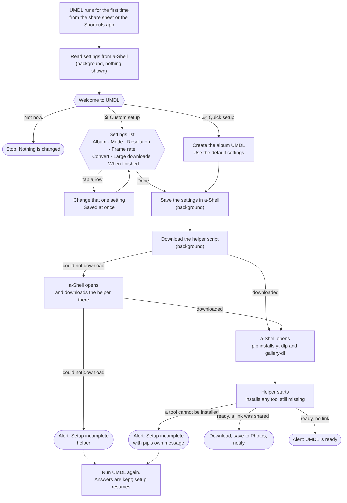
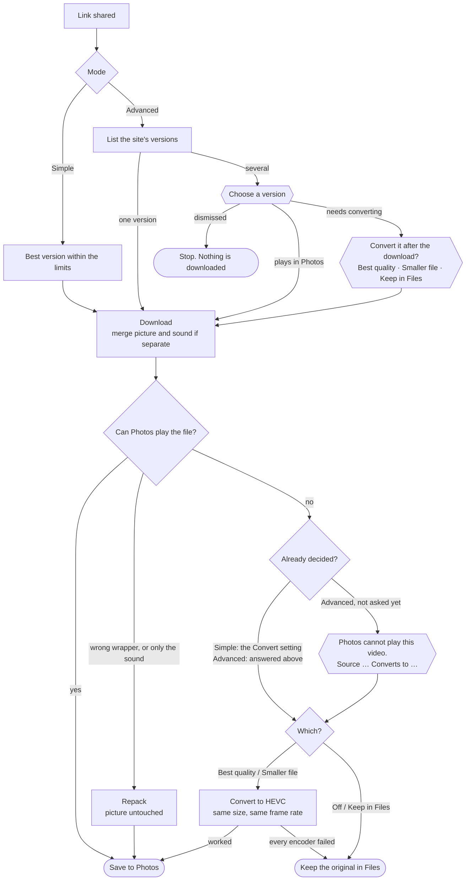

# Behaviour

Every screen UMDL can show, what leads to it, and what each choice does. This is the specification the shortcut is tested against: each row names the test that pins it down, and `tests/test_behavior_doc.py` fails if the shortcut shows a menu item or alert that is not described here.

Labels are written exactly as they appear. Tests are in `tests/test_shortcut_flow.py`, named here by class and then test.

- [How a run starts](#how-a-run-starts)
- [First run](#first-run)
- [Sharing a link](#sharing-a-link)
- [Which version is downloaded](#which-version-is-downloaded)
- [Converting for Photos](#converting-for-photos)
- [Advanced mode](#advanced-mode)
- [Reddit](#reddit)
- [Large downloads](#large-downloads)
- [When a download fails](#when-a-download-fails)
- [Unsaved and interrupted downloads](#unsaved-and-interrupted-downloads)
- [Opening UMDL from the Shortcuts app](#opening-umdl-from-the-shortcuts-app)
- [Status](#status)
- [Settings](#settings)
- [What UMDL asks a-Shell to do](#what-umdl-asks-a-shell-to-do)
- [Prompts that come from iOS](#prompts-that-come-from-ios)
- [What the tests can and cannot show](#what-the-tests-can-and-cannot-show)

## How a run starts

| Started by | UMDL receives | First thing shown |
|---|---|---|
| Share sheet, and the shared item contains a link | The link, or text with a link in it | Nothing. a-Shell opens and downloads. See [Sharing a link](#sharing-a-link) |
| Share sheet, shared text has no link | Text | The [main menu](#opening-umdl-from-the-shortcuts-app) (`OneTap.test_shared_text_without_a_link_opens_the_main_menu`) |
| Shortcuts app, Home Screen, widget, Siri | Nothing | The main menu |
| The helper in a-Shell, when it finishes | `UMDLCB:` and a result | Depends on the result: saved, a question, or an error |
| The helper could not be downloaded | `UMDL-HELPER-MISSING` | The alert **Setup incomplete** |

A run that is not a result from the helper always does these in order, and each step is skipped when it does not apply:

1. Reads settings and state from a-Shell in the background. Nothing is shown.
2. No settings: the [welcome screen](#first-run).
3. A finished download is waiting: the [unsaved download prompt](#unsaved-and-interrupted-downloads).
4. No link: the [main menu](#opening-umdl-from-the-shortcuts-app).
5. Opens a-Shell with the request.

## First run

UMDL counts a run as a first run when a-Shell holds no readable settings. That covers a new install, a reset, a deleted a-Shell, and a damaged settings file.



### Welcome

> **Welcome to UMDL**
>
> Saves shared posts and videos to Photos at the best quality.
>
> Setup takes about two minutes.

| Choice | Result | Test |
|---|---|---|
| ✅ Quick setup | Creates the album **UMDL**, saves the default settings, installs everything, and downloads the shared link if there was one. No further questions | `Onboarding.test_quick_setup_from_the_share_sheet_is_one_tap_and_downloads` |
| ⚙️ Custom setup | Opens the [Settings](#settings) list so anything can be changed first, then continues exactly as quick setup does | `Onboarding.test_custom_setup_is_the_settings_list_then_the_same_install` |
| Not now | Stops. Nothing is created in Photos or a-Shell. The welcome screen appears again next time | `Onboarding.test_declining_setup_changes_nothing` |

The defaults are: album **UMDL**, **Simple** mode, resolution and frame rate **Best available**, convert at **Best quality**, ask above **10** items, and **Show a notification** when finished.

### Custom setup

Custom setup is the Settings list itself, with two differences: there is no **Reset** row, and the last row, **Done**, reads "Install and finish". Every row works as described under [Settings](#settings).

| Situation | Result | Test |
|---|---|---|
| Rows are changed, then **Done** | Those values are saved and used by the download that follows | `Onboarding.test_custom_setup_is_the_settings_list_then_the_same_install` |
| **Done** with nothing changed | The same as quick setup, including the album **UMDL** | `Onboarding.test_custom_setup_left_as_it_is_equals_quick_setup` |
| **Album** set to an existing album, or to the library | Nothing is created in Photos | `Onboarding.test_custom_setup_with_an_existing_album_or_none` |
| A new album with an empty name | The name becomes `UMDL` | `Onboarding.test_an_empty_album_name_falls_back` |

### How setup ends

| Situation | Shown | Test |
|---|---|---|
| A link was shared | The download runs and is saved, exactly as in [Sharing a link](#sharing-a-link). No "ready" message | `Onboarding.test_quick_setup_from_the_share_sheet_is_one_tap_and_downloads` |
| No link | Alert **UMDL is ready**: "Share a post or video to UMDL to download it. Open UMDL in Shortcuts for settings." | `Onboarding.test_quick_setup_opened_from_the_app_installs_and_reports_ready` |
| The helper cannot be downloaded | Alert **Setup incomplete**: "The helper could not be downloaded. Check the connection, then run UMDL again." | `Onboarding.test_no_connection_during_setup_is_reported_and_the_next_run_finishes` |
| The helper cannot be downloaded in the background, but can in the app | Nothing extra. a-Shell downloads it before continuing | `Onboarding.test_helper_is_downloaded_in_the_app_when_the_background_cannot` |
| yt-dlp or gallery-dl cannot be installed | Alert **Setup incomplete**: "The download tools could not be installed.", then the reason pip gave | `Onboarding.test_tools_that_fail_to_install_are_reported_and_retried_next_time` |

After **Setup incomplete**, running UMDL again does not repeat the questions. The settings were saved before anything was downloaded, so the next run goes straight to whatever was missing.

Setup never shows the unsaved download prompt (`Onboarding.test_setup_never_reports_an_unsaved_download`).

### Updating from an earlier version

Installing a new version of the shortcut over an old one keeps the settings. The first run after the update downloads the matching helper, removes the Python environment 1.0 created, and continues with what was asked (`Onboarding.test_upgrade_from_1_0_refetches_the_helper_and_removes_the_old_environment`). Settings saved by earlier versions are kept. A missing mode, resolution or frame rate reads as **Simple** and **Best available**. Earlier conversion answers map to the nearest of today's: "convert" and "only when needed" become **Best quality**, "keep" and "never" become **Off** (`Settings.test_settings_saved_by_earlier_versions_are_read_and_upgraded`).

## Sharing a link

The path UMDL exists for. Once setup is done it asks nothing (`OneTap.test_download_asks_nothing`).

1. The first link in the shared item is used, wherever it sits in the text (`OneTap.test_link_is_pulled_out_of_shared_text`).
2. a-Shell opens and shows progress.
3. Shortcuts returns to the front, saves each file to Photos, and deletes the working copies.
4. A notification reports the result.
5. If the setting says so, Photos opens (`OneTap.test_open_photos_when_finished`).

### The notification

The title is the post's title, or `UMDL` when the site gives none.

| Result | Text | Test |
|---|---|---|
| One item, album set | Saved to the *name* album. | `OneTap.test_download_asks_nothing`, `OneTap.test_awkward_titles_and_album_names_survive` |
| One item, no album | Saved to Photos. | `OneTap.test_no_album_saves_to_the_library` |
| Several items | Saved *N* items to the *name* album. | `OneTap.test_gallery_post_saves_every_image` |
| Nothing could go to Photos | Nothing was added to Photos. | `OneTap.test_audio_is_kept_in_files` |
| A video was converted | A further line naming the change: 1 converted (VP9 → HEVC). | `Conversion.test_simple_mode_converts_with_the_saved_setting_and_says_so` |
| Some files were kept in Files | A further line: *N* kept in Files (a-Shell, UMDL, Saved). | `OneTap.test_audio_is_kept_in_files` |
| A file is over 1 GB | It is kept in Files, with a further line: *N* over 1 GB, kept in Files. | `OneTap.test_file_too_large_to_hand_over_is_kept_in_files` |
| Some items failed | A further line: *N* failed. | `OneTap.test_partial_download_saves_what_arrived_and_says_what_did_not` |

### After the notification

| Situation | Shown | Test |
|---|---|---|
| A newer UMDL has been released | "UMDL 1.5.0 is available. Installed: 1.4.0." with **⬇️ Get the update** (opens the release page) and **Later** | `OneTap.test_newer_release_is_offered_after_the_download`, `OneTap.test_declining_the_update_ends_quietly` |
| The shortcut and the helper are different versions | "UMDL is out of date." and the reason, with **⬇️ Get the latest version** and **Cancel**. Shown in place of the download | `OneTap.test_helper_from_another_version_is_reported_as_out_of_date` |

Three things happen without being shown:

- A download tool that has gone missing is installed again before the download (`OneTap.test_tools_removed_behind_umdls_back_are_reinstalled_on_the_way`), including when pip installs to a folder Python was not searching (`OneTap.test_tools_installed_where_python_is_not_looking_are_found`).
- A result UMDL cannot read is ignored, and the run continues as if nothing had been shared (`OneTap.test_unreadable_callback_falls_back_to_the_main_menu`).
- A Reddit link that Reddit refuses is tried by other routes before any error is shown. See [Reddit](#reddit).

## Which version is downloaded

Two questions are kept apart. Which version of a video to download is decided by **Resolution** and **Frame rate**. What to do with a file Photos cannot play is decided by **Convert**, described in the [next section](#converting-for-photos), and has no say in the first (`Quality.test_the_conversion_setting_does_not_change_what_is_downloaded`).



"Best" means, in this order:

1. The largest picture, up to the **Resolution** limit. A site with nothing at or under the limit gives its smallest version above it. The limit is the short side, so a tall phone video counts by its width.
2. The highest frame rate, up to the **Frame rate** limit. Versions above this limit are passed over even when they are larger; if the site has nothing at or under it, the lowest rate is taken.
3. Between versions equal in both, one Photos plays as it is (H.264 or HEVC, with AAC sound). Converting cannot add quality, so it is avoided when nothing is gained by it.

On most sites every version is H.264 and nothing is ever converted. YouTube is the exception: above 1080p it offers only VP9 and AV1, so its best version is downloaded and then converted.

| Situation | Result | Test |
|---|---|---|
| Simple mode | The best version is taken. Nothing is asked | `Quality.test_simple_mode_asks_nothing_and_takes_the_best_version` |
| A limit is set | Each limit is applied on its own | `Quality.test_each_limit_works_on_its_own` |
| Advanced mode | The versions are listed first; see [Advanced mode](#advanced-mode) | `AdvancedMode.test_lists_the_versions_and_downloads_the_one_picked` |

## Converting for Photos

Photos plays H.264 and HEVC video. The helper inspects every downloaded video with ffprobe and does the least that makes it playable. A file Photos already plays is never touched and never asked about, in either mode (`Conversion.test_a_file_photos_plays_is_never_asked_about`).

| The file | What is done | Quality |
|---|---|---|
| H.264 or HEVC with AAC, in MP4 or MOV | Nothing | Untouched |
| Playable picture in the wrong wrapper (MKV, WebM), or HEVC tagged `hev1` | Repacked into MP4. The picture is copied bit for bit | Untouched |
| Playable picture with Opus or Vorbis sound | The same repack; only the sound is re-encoded, to AAC at 256 kbit/s | Picture untouched |
| VP9, AV1 or another picture codec | Converted, kept in Files, or asked about: see below | |
| Sound only, or not media | Kept in Files | Untouched |

For the fourth row:

| Mode | What decides | Test |
|---|---|---|
| Simple | The **Convert** setting. **Best quality** unless changed, and when no setting was ever saved | `Conversion.test_simple_mode_converts_with_the_saved_setting_and_says_so`, `Conversion.test_with_no_setting_saved_the_conversion_is_best_quality` |
| Simple, Convert **Off** | The original is kept in Files | `Conversion.test_simple_mode_with_conversion_off_keeps_the_original` |
| Advanced | Asked each time, whatever the setting says | `Conversion.test_advanced_mode_asks_how_and_shows_source_and_result` |

### The two qualities

A conversion never changes the picture's size or frame rate. Sound that Photos plays is copied; other sound becomes AAC at 256 kbit/s.

| | Best quality | Smaller file |
|---|---|---|
| 1. HEVC, the device's hardware encoder, by quality level | 75 of 100 | 55 of 100 |
| 2. The same encoder, by bitrate | No lower than the source's | About half of that |
| 3. H.264, hardware encoder | A higher bitrate | About half of that |
| 4. H.264 in software. Slow; a last resort | Visually lossless | Good |

The steps are tried in order and the first that succeeds is used. A 10-bit source stays 10-bit in HEVC. Only encoders that a-Shell's ffmpeg has are tried; Status lists them under "Converts with". When every step fails the original is kept in Files and the notification says so (`Conversion.test_smaller_file_is_a_different_conversion`).

While a conversion runs, a-Shell shows how far it is in per cent. The notification names each conversion, for example "1 converted (VP9 → HEVC).", and the log records the ffmpeg arguments that were used.

### The question in advanced mode

Asked when a downloaded video needs converting and that was not already answered when the version was picked.

> *Title*
>
> Photos cannot play this video.
>
> Source: 1080p60 VP9 + Opus · 48 MB
> Converts to: 1080p60 HEVC + AAC

| Choice | Result | Test |
|---|---|---|
| 🎞️ Best quality | a-Shell converts as described above, then the file is saved to Photos | `Conversion.test_advanced_mode_asks_how_and_shows_source_and_result` |
| 🗜️ Smaller file | The same, at the smaller setting | `Conversion.test_smaller_file_is_a_different_conversion` |
| 📁 Keep in Files | The original is kept under *a-Shell › UMDL › Saved* | `Conversion.test_keeping_the_original_puts_it_in_files` |

With several files the first line reads "Photos cannot play 2 of these 5 files." and the answer applies to all of them. If the files have been removed from a-Shell in the meantime, the alert **Nothing to finish** says so.

## Advanced mode

Set with the **Mode** row in Settings. It asks whenever there is something to choose, and only then.

### Which version

a-Shell opens briefly, the helper lists what the site offers, and Shortcuts returns with a list of the same kind as the main menu:

> *Title*
>
> Best video: 2160p60 VP9 · 650 MB
> Best audio: Opus · 160 kbps
> Single file: 360p H.264 + AAC
> Your limit: 1080p 30 fps

"Best video" and "Best audio" are the best separate streams, which the tools merge. "Single file" is the best version that already holds both. "Your limit" appears only when a resolution or frame rate limit is set.

Up to three versions are offered, best first, and versions that would be the same download are listed once.

| Row, by example | Detail line | Meaning |
|---|---|---|
| 2160p60 · VP9 → HEVC | Best available · 653 MB | The best there is. The arrow says Photos cannot play it as it is, and names what it would be converted to |
| 1080p · H.264 | Best without converting · 83 MB | The best version Photos plays as it is |
| 360p · H.264 · single file | Nothing to merge · 10 MB | The best version the site serves as one file |

| Situation | Result | Test |
|---|---|---|
| A version Photos plays is chosen | a-Shell downloads exactly that one and the usual save follows | `AdvancedMode.test_lists_the_versions_and_downloads_the_one_picked` |
| A version with an arrow is chosen | One more question, straight away: "Photos cannot play this version. Convert it after the download?" with **🎞️ Best quality**, **🗜️ Smaller file** and **📁 Keep in Files**. Both answers go to a-Shell together, so it opens once more, not twice | `AdvancedMode.test_a_version_that_needs_converting_asks_how_before_the_download` |
| A limit is set | Nothing above it is offered, and the limit is shown | `AdvancedMode.test_the_limits_are_shown_and_applied` |
| The site has one version | No list. If Photos cannot play it, [the question](#the-question-in-advanced-mode) follows the download | `AdvancedMode.test_one_version_asks_nothing` |
| The link holds several videos | One list for all: "*N* items. One choice applies to all." with **Best available** (Whatever the format) and **Best without converting** (Only what Photos plays) | `AdvancedMode.test_a_link_with_several_videos_asks_once_for_all` |
| The list is dismissed | Stops. Nothing is downloaded | `AdvancedMode.test_cancelling_the_choice_downloads_nothing` |

Photo posts, and sites handled by gallery-dl, have one version and are not asked about.

Each step leaves a line in the helper's log: what was offered, when the helper handed back, when the shortcut received the list, and when a version was chosen. A log copied from Status therefore shows how far a run got (`AdvancedMode.test_each_step_leaves_a_line_in_the_log`).

## Reddit

On some networks Reddit refuses the download tools with "You've been blocked by network security", whether or not UMDL is signed in. Nothing about this is shown unless every route fails. The routes, in order:

| Route | What it does | Test |
|---|---|---|
| 1. gallery-dl, as for any site | Reads the post from Reddit's website, with the saved sign-in | `OneTap.test_gallery_post_saves_every_image` |
| 2. gallery-dl through Reddit's API | Used only when route 1 was blocked | `OneTap.test_reddit_link_blocked_on_the_website_is_fetched_through_the_api` |
| 3. yt-dlp | The usual second tool | |
| 4. a-Shell's own browser | Used only when a route above was blocked. The helper has the browser, where the sign-in lives, ask Reddit for the post, and gives the photo or video links it finds to the download tools | `RedditThroughTheBrowser.test_photo_post_is_saved_with_no_question` |

Route 4 happens inside a-Shell without the page being shown, and the browser is returned to whatever it was showing before (`RedditThroughTheBrowser.test_browser_is_returned_to_the_page_it_was_showing`). What it handles:

| Post | Result | Test |
|---|---|---|
| Photo or gallery | The original images are saved, in the post's order | `RedditThroughTheBrowser.test_photo_post_is_saved_with_no_question` |
| Video hosted by Reddit | Downloaded with sound by yt-dlp; the notification carries the post's title | `RedditThroughTheBrowser.test_video_post_goes_to_yt_dlp_with_its_manifest` |
| Link to another site | Downloaded from that site in the usual way | `RedditThroughTheBrowser.test_post_that_links_elsewhere_is_downloaded_from_there` |
| Gallery over the ask-first limit | The [large download](#large-downloads) question, with the exact count | `RedditThroughTheBrowser.test_large_gallery_still_asks_first` |
| Text post, or the browser does not answer | The [failed download](#when-a-download-fails) menu | `RedditThroughTheBrowser.test_post_without_media_and_a_browser_that_never_answers` |
| Reddit refuses the browser as well | The failed download menu, saying that Reddit refused this device or network | `RedditThroughTheBrowser.test_refusal_in_the_browser_too_is_reported_as_reddits` |

Links to other sites never involve the browser (`RedditThroughTheBrowser.test_other_sites_never_involve_the_browser`).

## Large downloads

When a link holds more items than the limit in Settings (10 unless changed), UMDL stops before downloading and asks.

> *Title of the playlist or profile*
>
> 37 items.

When the site does not say how many, the text is "More than 10 items." (`LargeDownloads.test_unknown_size_says_more_than`).

| Choice | Result | Test |
|---|---|---|
| ⬇️ Download all | Downloads every item | `LargeDownloads.test_download_all_first_only_and_cancel` |
| ⬇️ First 10 | Downloads up to the limit. The number shown is the limit | `LargeDownloads.test_more_than_ten_items_asks_then_limits` |
| ⬇️ First only | Downloads one | `LargeDownloads.test_download_all_first_only_and_cancel` |
| Cancel | Stops. Nothing is downloaded | `LargeDownloads.test_download_all_first_only_and_cancel` |

A link at or under the limit downloads without asking (`LargeDownloads.test_threshold_setting_is_respected`).

## When a download fails

> **Download failed**
>
> *The reason the site or the tool gave*
>
> *What to do about it*

The last line depends on the kind of failure (`Errors.test_each_kind_of_failure_gets_its_own_advice`, `Errors.test_error_menu_explains_and_cancels`):

| Kind of failure | Advice shown |
|---|---|
| The post needs an account | Sign in to the site, then try again. |
| No connection | Check the connection. |
| Removed, private or region-locked | The post may be private, removed or region-locked. |
| Copy-protected | Copy-protected media cannot be downloaded. |
| Site not recognised | This site may not be supported. |
| Anything else | Updating the tools fixes most failures. |

| Choice | Result | Test |
|---|---|---|
| 🔄 Try again | Runs the same download again. Parts already downloaded are reused | `Errors.test_try_again_succeeds_once_the_site_recovers` |
| 🛠️ Update tools and retry | Upgrades yt-dlp and gallery-dl first, then downloads | `Errors.test_update_tools_and_try_again` |
| 🔑 Sign in | Opens that site's sign-in page and confirms the sign-in. See [Sign in to a site](#sign-in-to-a-site) | `Errors.test_sign_in_from_a_failed_download_opens_that_sites_sign_in_page` |
| 📋 Copy details | Copies the UMDL version, the link, the error and the end of the helper's log, for a bug report. A notification confirms: "Details copied." | `Errors.test_error_details_can_be_copied_with_the_log` |
| Cancel | Stops | `Errors.test_error_menu_explains_and_cancels` |

One failure changes the text. When a site blocks the request and UMDL is signed in to that site, the reason reads "*Site* refused this device or network: *what the site said* Being signed in did not help. If a VPN is on, turn it off and try again.", and the advice to sign in is not shown (`Errors.test_a_block_while_signed_in_is_not_blamed_on_the_account`).

Two failures have their own screen in place of this menu: **Setup incomplete** (see [How setup ends](#how-setup-ends)) and **No link**, "Share a post or video to UMDL, or copy its link first."

## Unsaved and interrupted downloads

**A download that finished but never reached Photos**, for example because Shortcuts was closed during the hand-back. The next run, however it starts, begins with:

> An earlier download was not saved.

| Choice | Result | Test |
|---|---|---|
| 💾 Save now | Saves it and notifies. If this run also has a link, that download follows | `Recovery.test_unsaved_download_is_offered_again`, `Recovery.test_saving_an_earlier_download_then_continues_with_the_new_link` |
| 🗑️ Discard | Deletes the files, then carries on with the run | `Recovery.test_unsaved_download_can_be_discarded` |

This prompt appears only when such a download exists. It is never shown during setup, or on a run that is itself delivering a download.

If the files of that download have since been removed from a-Shell, **Save now** shows the alert **Nothing to save**, "Those files are no longer in a-Shell. Download the link again.", and the prompt does not return (`Recovery.test_unsaved_download_whose_files_are_gone_is_explained`).

**A download that was interrupted**, for example because a-Shell was closed. The main menu gains **Resume last download**, which repeats the request exactly as it was made (`Recovery.test_interrupted_download_can_be_resumed_from_the_menu`). Sharing the same link again has the same effect.

**A damaged settings file** is treated as no settings: the welcome screen appears (`Recovery.test_damaged_settings_file_restarts_setup_instead_of_failing`).

## Opening UMDL from the Shortcuts app

With no link to work on, UMDL shows its main menu straight away (`MainMenu.test_opening_from_the_app_goes_straight_to_the_main_menu`). Each row has an icon, a title and a line of detail.

| Item | Detail line | Result | Test |
|---|---|---|---|
| Download from clipboard | The link you copied | Downloads the first link on the clipboard. With no link there: alert **No link**, "The clipboard holds no link." | `MainMenu.test_download_from_clipboard`, `MainMenu.test_clipboard_without_a_link_is_explained` |
| Enter a link | Type or paste | Asks "Link" with the URL keyboard, then downloads. Anything that is not a link: alert **No link**, "That is not a web link." | `MainMenu.test_enter_a_link`, `MainMenu.test_entering_something_that_is_not_a_link` |
| Resume last download | Continue where it stopped | Listed only when a download was interrupted | `Recovery.test_interrupted_download_can_be_resumed_from_the_menu` |
| Settings | Album, quality, mode | Opens [Settings](#settings) | `Settings.test_one_list_shows_every_setting_with_its_value` |
| Sign in to a site | For private posts | See below | `MainMenu.test_sign_in_is_confirmed_once_the_site_has_stored_it` |
| Status | Sign-ins, versions, log | Opens [Status](#status) | `MainMenu.test_status_shows_sign_ins_versions_and_storage` |
| Update tools | Latest yt-dlp and gallery-dl | a-Shell upgrades the tools, then an alert **Download tools updated** lists the installed versions. If the upgrade fails the title is **The update could not be completed** | `MainMenu.test_update_tools_reports_back` |
| About UMDL | Version *x* | See below | `MainMenu.test_about_project_page_and_done` |

Dismissing the menu stops the shortcut.

### Sign in to a site

> Sign in to

Choices: **Instagram**, **X (Twitter)**, **Reddit**, **TikTok**, **Facebook**, **Another site**. "Another site" asks for the "Sign-in page address"; text that is not a web address gives the alert **Sign in**, "That is not a web address."

Then the alert **Sign in** says what follows: "Sign in on the page that opens. UMDL returns here once it is saved. If it does not, swipe in from the left edge and check Status."

a-Shell opens the site's sign-in page in its own browser, and the helper watches a-Shell's cookie store. UMDL does not see what is typed, and never reads a cookie's value, only which site it belongs to and its name. yt-dlp and gallery-dl read the same store, so nothing is copied anywhere.

| What happens | Shown | Test |
|---|---|---|
| The site stores a sign-in | Shortcuts returns to the front with the alert **Signed in to** *site*: "UMDL will use this sign-in for *site* links." | `MainMenu.test_sign_in_is_confirmed_once_the_site_has_stored_it` |
| The site was already signed in | The page is not opened. Alert **Already signed in to** *site*: "To switch accounts, sign out first: Settings, Reset." | `MainMenu.test_signing_in_again_reports_the_existing_sign_in` |
| No sign-in appears within 10 minutes | Alert **Sign-in not confirmed**: "No sign-in to *site* appeared within 10 minutes. Status shows whether it was saved. Some sites block sign-in from in-app browsers." | `MainMenu.test_sign_in_that_was_not_completed_says_so` |
| A site that is not in the list | The address entered is opened as it is. A sign-in is recognised by a session cookie for that site, and confirmed under the site's domain name | `MainMenu.test_sign_in_to_another_site` |

For the five listed sites "signed in" means the site's own session cookie is present and has not expired. Visiting a site without signing in does not count.

### About UMDL

> **UMDL 1.4.0**
>
> Free and open source.
> Built on yt-dlp, gallery-dl and a-Shell.

| Choice | Result | Test |
|---|---|---|
| 🔄 Check for updates | Up to date: alert **Up to date**. Newer release: "UMDL 1.5.0 is available. Installed: 1.4.0." and its release notes, with **⬇️ Get the update** and **Later**. No connection: alert **Update check**, "GitHub could not be reached." | `MainMenu.test_check_for_new_version` |
| 🌐 Project page | Opens the repository on GitHub | `MainMenu.test_about_project_page_and_done` |
| Done | Closes the menu | `MainMenu.test_about_project_page_and_done` |

## Status

**Status** in the main menu opens a-Shell for a few seconds, then shows the alert **Status**. It answers "is everything in place?" and "am I signed in?" (`MainMenu.test_status_shows_sign_ins_versions_and_storage`).

```
UMDL 1.4.0, helper 1.4.0
a-Shell 2.4.0 (613)
Python 3.13.1
yt-dlp 2026.11.23
gallery-dl 1.32.21
ffmpeg n7.0
Converts with: hevc_videotoolbox, h264_videotoolbox
Tools last updated: 25 Nov 17:20

Sign-ins
Instagram: signed in
X (Twitter): signed in
Reddit: signed in
TikTok: not signed in
Facebook: not signed in
Other sites that may be signed in: example.org

Storage
Working files: 0 bytes
Kept in Files: 2 items
Unsaved download: none
Free space: 41.3 GB

Checks
Download tools: ready
GitHub: reachable
Last download: 25 Nov 17:36, failed (auth)
```

The values above are examples. "Converts with" lists the video encoders a-Shell's ffmpeg has, in the order UMDL tries them. When nothing has ever been stored, the sign-in section reads "No sign-ins are stored."

After the alert:

> Copy the status and log?

| Choice | Result | Test |
|---|---|---|
| 📋 Copy | Copies the status text and the end of the helper's log of the last download. A notification confirms: "Status and log copied." Works when there is no log yet | `MainMenu.test_status_and_log_can_be_copied`, `MainMenu.test_copying_status_before_any_download_does_not_fail` |
| Done | Closes the menu | `MainMenu.test_status_shows_sign_ins_versions_and_storage` |

The log holds the link, which tool was tried, the version chosen, any conversion and the error each tool reported. It holds no cookies and no passwords.

## Settings

One list, titled **Settings**, which stays open until **Done**. Each row shows its current value (`Settings.test_one_list_shows_every_setting_with_its_value`, `Settings.test_defaults_read_plainly`). A change is saved the moment it is made, and the list returns with the new value (`Settings.test_the_list_stays_open_and_each_change_is_saved_at_once`). Closing the list after a change shows the notification "Settings saved." Settings never open a-Shell, except **Reset**.

A row with two values switches when tapped, with no menu in between (`Settings.test_two_value_rows_switch_when_tapped`). A row with more opens one menu, never a second.

| Row | Value shown | Tapping it | Test |
|---|---|---|---|
| Album | The album's name, or "Library only" | Menu **Save to**: **🆕 New album** asks "Album name" and creates it; **🖼️ Existing album** asks "Album name, as Photos shows it"; **📚 Library only** uses no album | `Settings.test_change_album` |
| Mode | "Simple · uses these settings" or "Advanced · asks each time" | Switches | `Settings.test_two_value_rows_switch_when_tapped` |
| Resolution | "Best available" or "Up to 1080p" | Menu **Highest resolution**: Best available, 2160p (4K), 1440p, 1080p, 720p, 480p | `Settings.test_resolution_and_frame_rate_choices` |
| Frame rate | "Best available" or "Up to 30 fps" | Menu **Highest frame rate**: Best available, 60 fps, 30 fps | `Settings.test_resolution_and_frame_rate_choices` |
| Convert | "Best quality", "Smaller file" or "Off" | Menu **When Photos cannot play a video**: Best quality, Smaller file, Off. Advanced mode asks each time instead | `Settings.test_conversion_choices` |
| Large downloads | Ask above *N* items | Asks "Ask before downloading more than", filled in with the current number. Accepts 1 to 9999. Anything else: alert **Not saved**, "Enter a whole number from 1 to 9999.", and the list returns | `Settings.test_change_threshold`, `Settings.test_a_bad_threshold_is_refused_and_the_list_returns` |
| When finished | "Show a notification" or "Open Photos" | Switches. A notification is shown either way | `Settings.test_two_value_rows_switch_when_tapped` |
| Reset | Sign out, or remove everything | See below. Not listed during setup | `Settings.test_reset_sign_out` |
| Done | "Close settings", or "Install and finish" during setup | Closes the list | `Settings.test_one_list_shows_every_setting_with_its_value` |

Resolution and Frame rate are described under [Which version is downloaded](#which-version-is-downloaded), Convert under [Converting for Photos](#converting-for-photos).

### Reset

> **Reset**
>
> Remove everything also deletes UMDL's files and tools in a-Shell. Photos are kept.

| Choice | Result | Test |
|---|---|---|
| 🔑 Sign out of all sites | a-Shell deletes its stored cookies and the tools' saved tokens. Alert **Signed out**; if that fails, **Could not sign out**. Settings are kept | `Settings.test_reset_sign_out` |
| 🗑️ Remove everything | a-Shell uninstalls yt-dlp and gallery-dl, signs out of every site, and deletes UMDL's folder, including files kept under *Saved*. Alert **UMDL was reset**. The next run is a first run | `Settings.test_reset_everything_removes_umdl_the_tools_and_the_sign_ins` |
| Cancel | Returns to the list. Nothing is changed | `Settings.test_reset_can_be_cancelled` |

**Remove everything** returns a-Shell to how it was before UMDL, as far as UMDL can tell what is its own. It does not touch files you keep in a-Shell for other purposes, other Python packages, or a-Shell's own settings. Deleting the a-Shell app removes those too. Nothing in Photos is ever removed.

## What UMDL asks a-Shell to do

a-Shell runs commands for a shortcut in two ways. Background commands return their output without a-Shell appearing, but cannot run Python. Commands in the app open a-Shell.

| When | Where | Command |
|---|---|---|
| Start of every run that is not a result | Background | Print the settings file, the helper's version marker, and any unsaved or interrupted download |
| A setting is changed | Background | Write `config.b64` |
| Before saving to Photos | Background | `cat` the list of files of that download |
| Each file to save | a-Shell's Get File action, as a copy | Hand one file to Shortcuts |
| Files saved to Photos, or discarded | Background | Delete that download's working folder |
| Copy details, copy status and log | Background | `tail` the last 40 lines of the helper's log |
| Check for updates | Background | `curl` this repository's `version.json` |
| Helper missing, or from another version | Background | `curl` `src/umdl.py` from this repository, and record which shortcut version fetched it |
| The same, when the background download fails | In the app | The same download, typed into the a-Shell window |
| After the helper was fetched | In the app | `pip install --upgrade yt-dlp gallery-dl`, before the helper starts |
| Download, finish a download (advanced mode), setup, update tools, status, sign in, sign out, remove everything | In the app | `python umdl.py <command> <request>` |
| Listing versions, checking and converting files | By the helper | yt-dlp without downloading; `ffprobe`; `ffmpeg` |
| Remove everything | By the helper | `pip uninstall` the download tools, delete the cookie store and `~/Documents/UMDL` |
| Sign in | By the helper | `internalbrowser <address>`, then it watches the cookie store |
| Reddit, when the tools are refused | By the helper | `jsc <script>`, which runs a short script in a-Shell's web view |

Every background command is run with a-Shell's "continue after an error" option, and every Get File asks for a copy. Without either, a-Shell reports a failed action and Shortcuts stops with "There was a problem running the shortcut", naming neither the action nor the reason (`Hygiene.test_background_commands_survive_a_failing_command`, `Hygiene.test_get_file_always_asks_for_a_copy`).

The helper also keeps the tools current by itself: it installs any that are missing, upgrades them once a day, and replaces itself when this repository publishes a newer helper for the same protocol.

## Prompts that come from iOS

These are shown by iOS, not by UMDL, the first time each permission is needed. Choosing **Always Allow** stops them. The simulator cannot show them.

- Allow UMDL to run actions from a-Shell
- Allow UMDL to save to Photos, and to create an album
- Allow UMDL to send notifications
- Allow UMDL to open another app or a link
- Allow UMDL to read the clipboard, for **Download from clipboard**
- Allow a-Shell to run the UMDL shortcut, when the helper hands back

A first run from the share sheet can therefore need several taps on **Allow** before the single tap on **Quick setup** takes effect. After that, sharing a link needs none.

## What the tests can and cannot show

The flow tests run the compiled shortcut, action by action, in `tests/shortcut_sim.py`, against the real helper script. yt-dlp, gallery-dl, pip and curl are replaced by stand-ins in `tests/fakes`, so a test can stage an offline device, a failed install, a playlist of any size, a site with many versions of a video, or a site that returns an error. ffmpeg and ffprobe are the real ones, so repacking and conversion are actually carried out.

That shows the logic is right. It cannot show how iOS behaves. Device tests have found five things the tests had wrong or could not see, and each is now part of the simulator, so the old build fails in it the way it failed on the phone:

| Found on a device | What it caused | Now |
|---|---|---|
| An empty text counts as having a value in an **If** action (1.0.0) | A false "unsaved download" prompt on every run, and no main menu | The shortcut compares with `[]` instead; `Hygiene.test_no_condition_relies_on_has_any_value` |
| On iOS 27.2, a-Shell's **Get File** stops the shortcut unless it is asked for a copy ([a-Shell issue 1138](https://github.com/holzschu/a-shell/issues/1138)) (1.1.0) | "There was a problem running the shortcut" after every successful download | Get File always asks for a copy; `Hygiene.test_get_file_always_asks_for_a_copy` |
| A background a-Shell command that exits with an error stops the shortcut the same way (1.1.0) | The same message, with no cause named | Every background command continues after an error; `Hygiene.test_background_commands_survive_a_failing_command` |
| On iOS 27.2, a-Shell's `jsc` cannot hand a script's value back, not even a text (helper 1.2.2) | The Reddit browser route stopped at its first step | Scripts report through a-Shell's print channel and leave no value; the stand-in `jsc` refuses any other kind, and `tests/test_reddit_js.py` runs the script in Node |

| In a-Shell, yt-dlp's challenge solver for YouTube runs in a web view, and one line of it sends that web view to a YouTube address. iOS opens the YouTube app for it (1.3.0, 1.4.0) | Every YouTube link ended in the YouTube app on "This video is unavailable"; a-Shell, no longer in front, could not hand back | The helper defuses that line before the script runs (helper 1.4.1); `tests/test_umdl.py`, `SolverInAWebView`. No simulator can show the app switch itself |

Other checks on the shortcut as built: `Hygiene.test_every_action_in_the_shortcut_is_modelled`, `Hygiene.test_shortcut_metadata`, `Hygiene.test_unscripted_question_fails_loudly`.

Confirmed on a device so far:

- Setup, the download tools installing, and a download running in a-Shell.
- The Settings list, in Custom setup, returning after each change (1.3.0).
- a-Shell's ffmpeg has the hardware encoders: Status shows "Converts with: hevc_videotoolbox, h264_videotoolbox".
- The main menu and the menus under it.
- The helper's result reaching the shortcut, the failed-download menu, and copying details.
- Signing in, and private posts downloading with the sign-in (Instagram and X).
- Saving to Photos.
- Status, and copying the status and the log.

Not yet confirmed on a device, and so the first things to check ([device checklist](BUILDING.md#device-checklist)):

- Any YouTube download, in either mode.
- A conversion with the hardware encoder: that it runs, which of its two steps is used, and how long 4K takes.
- The version list of Advanced mode. It has never been reached on a device: both attempts were YouTube links, and both were taken to the YouTube app before the helper could hand back (see the table above). Helper 1.4.1 removes that cause.
- Reddit through a-Shell's browser, now that scripts report through the print channel. Each step is written to the log, so a failure there can be read from Status, **📋 Copy**.
